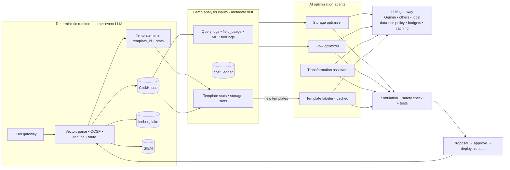

# AI Data Optimization and Transformation (Gemini and other LLMs)

- Status: Draft v0.1
- Date: 2026-10-14
- Related: requirements G0 (cost) and GA (agentic-native), NFR-COST-03/04,
  [`mvp-scope.md`](mvp-scope.md), [`zero-cost-mvp.md`](zero-cost-mvp.md),
  architecture §5.7 (cost) and §8 (agents)

## 1. Intent

Use LLMs such as **Google Gemini**, through the same model-agnostic gateway as
any other provider, to:

1. **Optimize data flows**: find and remove data that nobody uses, data
   stored twice, data kept too long, or data sent to the expensive tier
   without need.
2. **Eliminate unneeded storage**: retention, tiering, compaction, field
   pruning and dedup proposals across ClickHouse, the Iceberg lake, the raw
   archive and SIEM destinations.
3. **Perform data transformations**: generate, test and maintain parsers,
   OCSF mappings, enrichments, reductions and routing from samples or
   plain-language requests.

### The key design rule: the LLM designs the pipeline, deterministic code runs it

Calling an LLM on every event would make transformation cost scale with
tokens instead of CPU. At even modest volumes, that costs more than the SIEM
we are trying to save money on. It also adds latency and makes results
non-deterministic. So OSDF uses LLMs in four ways, from most to least preferred:

| Mode | What the LLM does | Runtime cost | Use for |
|---|---|---|---|
| **A. Design time (compiler)** | Writes VRL/OCSF mappings, reduction rules, routing, retention and storage settings, which are then tested and deployed as normal code | **Zero tokens per event** | All transformations and optimizations (default) |
| **B. Per-template, cached** | Labels/parses each new **log template** once (template mining, LILAC-style adaptive cache). The result becomes a deterministic rule | Tokens per *new template*, not per event (thousands of times fewer calls) | Long-tail, unknown or messy log formats; event-type classification for tiering |
| **C. Batch analysis** | Periodic analysis over metadata and samples (field usage, query logs, volumes, storage stats) to find optimizations | Bounded per run; batch APIs are ~50% cheaper | Storage/flow optimization reports and proposals |
| **D. Runtime AI step (opt-in, guarded)** | Calls the model for selected, **low-volume** events (for example, summarizing alerts, extracting entities from free-text tickets) | Tokens per selected event, capped by budget | Exceptions only; must pass a cost check |

NFR-COST-03 is updated to say: *no LLM in the per-event path **by default**.
Mode D is allowed only for routes with a declared rate cap, a token budget
and a cost-check pass, and never on the main ingestion path.*

---

## 2. Capabilities

### 2.1 Storage optimizer (eliminate unneeded storage)

An agent (an extension of the cost optimization agent, FR-AGT-02) runs a
scheduled **batch analysis** (mode C) and opens proposals:

| Finding | Evidence it uses | Typical proposal |
|---|---|---|
| **Never-queried data**: tables, OCSF classes, sources or fields not read by any detection, search, dashboard or agent in N days | `field_usage`, ClickHouse `system.query_log`, lake query logs, MCP tool-call logs, SIEM rule inventory | Move to archive-only; drop fields; shorten retention |
| **Duplicate storage**: the same events kept in SIEM + ClickHouse + lake + archive without need | Destination fan-out config, `cost_ledger` | Remove a destination, or keep only the lake + archive |
| **Over-retention**: hot or SIEM retention longer than any query lookback or compliance rule requires | Query lookback distribution, compliance policy settings | Shorten hot TTL; move to warm/archive |
| **Redundant raw copies**: raw text kept next to fully parsed fields | Parser coverage %, `raw_data` usage | Drop `raw_data` after parse (bronze archive keeps the original) |
| **Poor compression / layout** | Table compression ratios, codecs, sort keys, small-file counts in Iceberg | ClickHouse codec/sort-key change; Iceberg compaction/partition change |
| **Chatty, low-value event types** | Volume by template/event type × usage | Dedup, suppress, aggregate to metrics, sample |
| **Silent duplicates across sources**: the same log collected twice (agent + forwarder) | Template fingerprints + host/source overlap | Disable one collection path |

Every proposal goes through the existing **what-if simulation** and the
**detection-safety check** (FR-CST-07/08), and shows **GB and $/month saved**.
Nothing is deleted without approval. The raw archive remains the safety net,
unless the archive policy itself is what's being changed, which needs an
explicit admin approval and a compliance-retention check.

### 2.2 Flow optimizer (optimize data flows)

- **Natural-language routing changes:** a user types "Send only failed logins
  and admin actions from Okta to Splunk, keep everything in the lake". The
  model writes the route and tier policy, the platform simulates the cost and
  checks detection safety, and the user approves.
- **Tier classification at template level** (mode B): every event template
  gets a label of *detect-critical*, *investigate*, *compliance* or *noise*,
  with a rationale. The labels become deterministic routing rules. A human
  reviews the label table once, and new templates are labeled as they appear.
- **Pipeline review:** the model reviews existing pipelines for redundant
  steps, expensive regexes, missing early filters (filter before parse) and
  fan-out duplication, and proposes rewrites that are benchmarked in the
  validator sandbox (throughput and CPU before and after).

### 2.3 Transformation assistant (data transformations)

| Task | How |
|---|---|
| New source parser + OCSF mapping | Onboarding agent (FR-AGT-01), using samples and the connector package; outputs a mapping DSL/VRL + fixtures |
| Natural-language transform ("mask emails in user fields, add geo to src_ip, rename vendor fields to OCSF") | Transformation agent writes pipeline steps; tests generated from samples; diff + before/after preview |
| Fix broken parsing / drift | Drift agent (FR-AGT-03), using DLQ samples |
| Normalize to other schemas (ECS/CIM) on output | Model generates adapter mappings; validated against schema |
| Enrichment design | Model proposes lookups/joins (asset, identity, TI) with expected value and cost |
| Warehouse transformations (post-MVP offload) | Same mapping compiled to Snowflake/Spark SQL (saas doc §4.3) |

All outputs are **code + tests**, proposed through the normal review flow.

### 2.4 Log template mining (mode B foundation)

- A deterministic **template miner** (Drain-family algorithm) runs in the
  pipeline (Vector or a small sidecar on sampled traffic). It assigns each event a
  `template_id` and stores template statistics (count, bytes, first and last
  seen, example) in ClickHouse.
- **New templates** trigger an LLM call, cached per template, that returns a
  parsing pattern, an OCSF class guess, a tier label and a description. LLM-based
  parsers with an adaptive template cache have shown high accuracy at speeds
  comparable to Drain in research (for example, LILAC, FSE 2024), because
  most events hit the cache.
- The cache is versioned content: approved labels and parsers are committed
  like any other mapping, so behavior is reproducible.
- Template stats also power the storage optimizer's "chatty template" findings.

---

## 3. Gemini integration (provider-agnostic)

OSDF stays model-agnostic (FR-AGT-12). Gemini is a first-class, recommended
option because it has a free tier for development, low-cost Flash-Lite models
and a batch API:

| Use | Suggested Gemini tier (check current models and prices) | Why |
|---|---|---|
| Template labeling, classification (mode B) | **Flash-Lite** class | Cheapest per token; short, structured outputs |
| Storage/flow analysis reports (mode C) | **Flash** class via the **Batch API** (~50% discount) | Large context of metadata; not latency-sensitive |
| Parser/mapping generation, NL transforms (mode A) | **Flash**, escalating to **Pro** on repeated test failures | Code quality matters; volume is low |
| Copilot chat | Flash | Interactive latency |

Cost controls: prompt/context caching for the OCSF schema and connector
docs (cached input tokens are much cheaper), structured output (JSON schema)
to avoid retries, per-agent token budgets, and model escalation only on
failure. All usage is written to the `cost_ledger`, and AI spend is shown next
to the savings it produced (**net savings**).

**Data policy by environment:**

| Environment | Gemini access | Data allowed |
|---|---|---|
| Development / $0 MVP | Gemini API free tier (Google AI Studio key) | **Synthetic or sanitized data only.** Free-tier inputs may be used to improve Google's products |
| Design partner / production | **Vertex AI** in the customer's own Google Cloud project, or the paid Gemini API under its paid-tier terms | Real data, under the customer's agreement with Google. Check the data-use and residency terms for the chosen service and region |
| Air-gapped | Local open-weight models instead | Real data |

The LLM gateway enforces this with a per-provider **data-use flag**
(`trains_on_input: true|false`) and the existing PII/secret masking on
egress (NFR-AI-02). Real-data routes are blocked from providers flagged `true`.

Because analysis runs on **metadata, statistics and small redacted samples**
(field names, counts, templates, query patterns), most optimization work never
sends raw event content to a model at all.

---

## 4. Requirements (FR-AIO)

| ID | Requirement | MVP priority |
|---|---|---|
| FR-AIO-01 | **Storage optimizer**: scheduled batch analysis of usage, retention, duplication and layout; proposals with simulation, safety check and $ saved | **Must (lite)**: never-queried fields/event types, duplicate destinations, over-retention |
| FR-AIO-02 | **Flow optimizer**: natural-language routing/tier changes compiled into routes, with cost preview | **Must** (part of J4/J5 UX) |
| FR-AIO-03 | **Transformation assistant**: natural-language transforms → pipeline steps + tests + preview | **Must (lite)**: mask, drop, rename, route; Should: enrichments |
| FR-AIO-04 | **Template miner** (deterministic) with template stats in ClickHouse | **Must** |
| FR-AIO-05 | **Per-template LLM labeling/parsing with an adaptive cache** (mode B), with labels reviewed as content | Should |
| FR-AIO-06 | **Pipeline performance review** (benchmark before and after in the sandbox) | Post |
| FR-AIO-07 | **Runtime AI step** (mode D) with rate cap, budget and cost check | Post |
| FR-AIO-08 | **Model-agnostic gateway with Gemini as a first-class provider**: API key (dev) and Vertex AI (prod), batch API support, context caching, structured output | **Must** (Gemini API + one other provider); Vertex AI: Should |
| FR-AIO-09 | **Data-use policy per provider** enforced at the gateway (`trains_on_input`), plus masking | **Must** |
| FR-AIO-10 | **AI cost accounting**: tokens and $ per agent run in the `cost_ledger`; net savings = storage/ingest saved − AI and platform cost | **Must** |
| FR-AIO-11 | **Optimizer evals**: labeled datasets where the correct optimizations are known; measure the share of savings found and the false-positive rate (proposals that would break a detection) | **Must** for FR-AIO-01/02/03 |

UX additions (mvp-scope): the **recommendations inbox** (J4) shows a
"Storage" category next to "Ingest". The **copilot** accepts transformation
requests ("mask emails in Okta logs") and opens a proposal. The **change
history** labels AI-generated changes with model, cost and evidence.

---

## 5. Architecture additions

ADR-21: **LLMs act as pipeline compilers and analysts, not as per-event
processors.** Gemini is a first-class provider behind the model-agnostic
gateway. Mode D (runtime AI) is an explicit, budgeted exception.

---

## 6. Fit with the $0 MVP
- **Development:** the Gemini API free tier on synthetic data covers onboarding,
  transformation, template labeling and optimizer development (modes A–C are
  low-volume by design).
- **Design partner:** their Vertex AI project or paid key (BYO key), so the
  cost falls on them and is usually small, since optimization runs on metadata
  and batch calls.
- **Lean profile:** the template miner is a Vector transform or a small Python
  sidecar on sampled events (≤ 0.2 GB memory).

## 7. Timeline placement (mvp-scope §7)

| Weeks | Work |
|---|---|
| 1–4 | LLM gateway with Gemini + data-use policy; cost accounting for tokens |
| 4–7 | Template miner + template stats; field-usage capture from query logs |
| 7–10 | Storage optimizer (lite) + flow optimizer (NL routing) in the recommendations inbox |
| 10–13 | Transformation assistant (lite) in the copilot; optimizer evals in CI |
| 13–16 | Should: per-template labeling cache (mode B) |

## Sources
- LILAC: log parsing using LLMs with an adaptive parsing cache (FSE 2024): https://arxiv.org/pdf/2310.01796
- LLMs for SOCs survey: https://arxiv.org/pdf/2509.10858
- MicLog multi-level cache log parsing: https://web3.arxiv.org/pdf/2601.07005
- Gemini API pricing 2026 (third-party summary; verify on Google's pricing page): https://www.morphllm.com/gemini-api-pricing
- Gemini API pricing hub (third-party): https://benchlm.ai/google/api-pricing
- Gemini API free tier changes (Apr 2026): https://agentdeals.dev/gemini-api-pricing-changes
- Free AI APIs: official limits and data policies: https://aireiter.com/blog/best-free-ai-api
