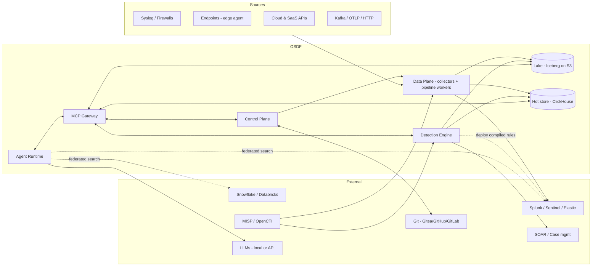
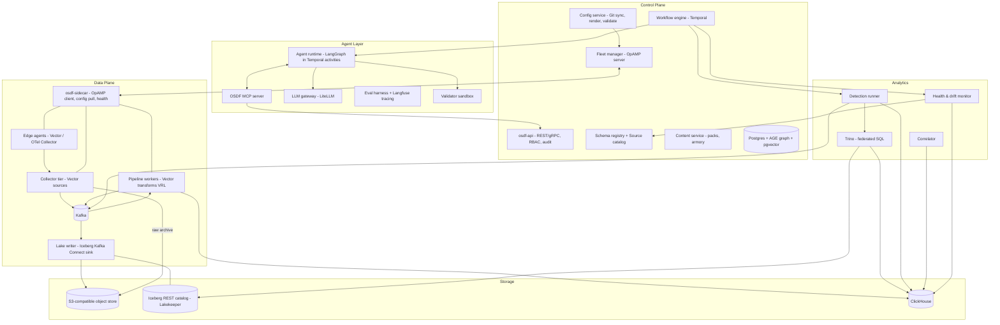
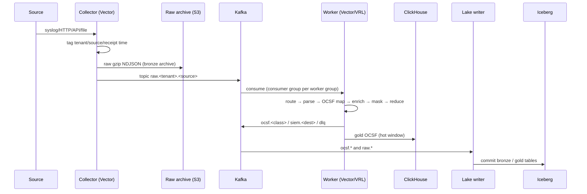
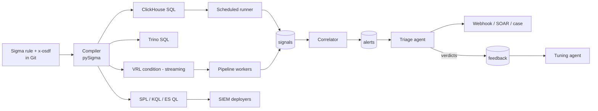
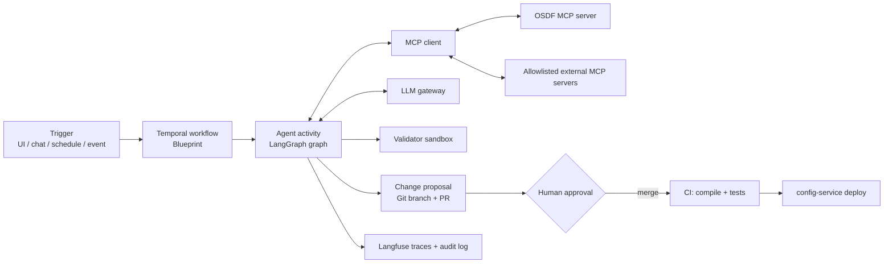

# Architecture: OpenSOC Data Fabric (OSDF)

- Status: Draft v0.1
- Date: 2026-10-14
- Requirements: [`requirements.md`](requirements.md) (IDs such as `FR-PIP-01` are referenced below)

---

## 1. Architectural principles

1. **Assemble, don't reinvent.** Use proven open source engines for the
   heavy parts (stream transport, transforms, storage, query, workflow).
   OSDF's own code is the **control plane, the content model, the
   detection compiler glue, and the agents**. Commercial vendors differentiate
   in these areas too.
2. **Control plane and data plane are separate** (the Cribl leader/worker model).
   The data plane runs on its last known good config when the control plane is down.
3. **Git is the source of truth** for all content: pipelines, routes, parsers,
   OCSF mappings, detections, packs and blueprints. The UI, CLI and agents all
   write *proposals* (branches/PRs). A deploy happens only from a merged commit.
4. **Open formats at rest.** OCSF events in Iceberg/Parquet on object storage.
   Any engine can read the lake, and there is no lock-in.
5. **Storage-agnostic detections** (the Anvilogic model). Sigma is the source,
   compiled per backend. OSDF can run detections itself or push them to a SIEM.
6. **Agents propose, deterministic checks verify, humans approve.** LLM output
   never reaches production without passing compilers, schema validators
   and tests.
7. **Log data is untrusted input.** Anything derived from events and given to
   an LLM is treated as possible prompt injection (see §8.4).

---

## 2. System context



---

## 3. Logical architecture (planes and modules)



### 3.1 Module responsibilities

| Module | Responsibility | Built on | Reqs |
|---|---|---|---|
| `osdf-api` | Public API, RBAC, tenancy, audit log, proposal lifecycle | Python FastAPI + Postgres, Keycloak (OIDC), OPA (policy) | FR-API-01, NFR-SEC-* |
| `config-service` | Pulls Git, renders OSDF YAML into engine configs (Vector TOML/YAML, ClickHouse DDL, compiled rules), validates, versions and stages rollouts | Python, Jinja/pydantic, `vector validate` | FR-PIP-01/02/13, NFR-OPS-04 |
| `fleet-manager` | Agent and worker enrollment, grouping, config distribution, health, version rollout | Go, `opamp-go` server | FR-COL-04 |
| `osdf-sidecar` | Runs next to every Vector/OTel process. OpAMP client: pulls config, validates locally, hot reloads, rolls back on failure, reports health | Go, `opamp-go` client | FR-COL-04, NFR-REL-02 |
| Collector tier | Network listeners and API pullers. Writes raw to Kafka plus the raw archive | Vector (sources), OTel Collector (OTLP), declarative REST connector runner | FR-COL-* |
| Kafka | Durable bus and persistent queue. Decouples ingest from processing and destinations | Apache Kafka (KRaft) | FR-PIP-06, NFR-REL-03 |
| Pipeline workers | Parse, normalize to OCSF, enrich, mask, reduce, route, fan out | Vector + VRL, Presidio-derived rule packs for the guard | FR-PIP-*, FR-SCH-* |
| Lake writer | Kafka → Iceberg tables (bronze/silver/gold), exactly-once commits | Apache Iceberg Kafka Connect sink (or a pyiceberg micro-batch writer for the MVP) | FR-LAK-01/02 |
| Hot store | Fast scheduled detections, search, dashboards, signals/alerts tables | ClickHouse | FR-LAK-04, FR-SRC-01 |
| Lake | System of record, replay source, long-term hunting | Iceberg + Lakekeeper REST catalog + object storage | FR-LAK-* |
| Trino | One SQL endpoint over Iceberg + ClickHouse (+ PostgreSQL, OpenSearch connectors) | Trino | FR-SRC-01 |
| Federated adapters | Query external SIEMs/lakes in their native language and normalize results | Python adapters (Splunk REST, Azure Monitor Query, Elastic, Snowflake, Databricks SQL) | FR-SRC-02 |
| Detection compiler | Sigma + `x-osdf` → backend queries. Custom ClickHouse and VRL backends | pySigma + backends | FR-DET-01/02 |
| Detection runner | Scheduled windowed execution, dedup, signal/alert emission, SIEM deployers | Python worker, Temporal schedules | FR-DET-03 |
| Correlator | Signals → alerts (sequence/threshold/risk) | ClickHouse SQL (MVP), Apache Flink (P2, for streaming state) | FR-DET-06 |
| Health & drift | Silence, volume, schema drift, data-quality score | Python + ClickHouse aggregates, Prometheus metrics | FR-HLT-* |
| Graph | Source↔field↔detection↔ATT&CK↔CTI, plus embeddings for retrieval | PostgreSQL + Apache AGE + pgvector | FR-GRF-* |
| Agent runtime | Agent graphs, tools, memory, human-in-the-loop | LangGraph (Python), run inside Temporal workflows | FR-AGT-* |
| MCP server | Exposes platform tools to OSDF agents *and* external clients (Claude, IDEs) | Python MCP SDK | FR-API-02 |
| LLM gateway | Model routing, fallback, budgets, PII redaction before egress | LiteLLM proxy; vLLM or Ollama for local models | FR-AGT-12, NFR-AI-02 |
| Validator sandbox | Runs untrusted generated artifacts (VRL tests, SQL dry runs, Sigma compile) in isolated, network-less containers | gVisor/Kata or plain rootless containers with no network; `vector test`, ClickHouse `EXPLAIN` | NFR-AI-01/04 |
| Observability | Self-telemetry, dashboards, LLM tracing | OpenTelemetry, Prometheus, Grafana, Langfuse | NFR-OPS-02, NFR-AI-03 |
| Integrations | TI, cases, SOAR | OpenCTI/MISP, DFIR-IRIS, Shuffle (webhooks) | FR-PIP-10, FR-API-05 |

---

## 4. Recommended open source stack

> Verify the license and maintenance status of each component at adoption
> time (NFR-LIC-01). Alternatives are listed where the first choice has a risk.

| Layer | Choice | License | Alternatives / notes |
|---|---|---|---|
| Edge/collector/transform engine | **Vector** | MPL-2.0 | Fluent Bit (Apache-2.0) for very small footprints; OTel Collector (Apache-2.0) for OTLP-native and OpAMP-native fleets; Tenzir (executor BSD-3, but check which parts are closed) |
| Transform language | **VRL** (Vector Remap Language) | MPL-2.0 | Chosen because it is typed, sandboxed, fast, has built-in unit tests (`vector test`), and is easy for LLMs to generate and for compilers to verify |
| Fleet protocol | **OpAMP** (`opamp-go`) | Apache-2.0 | — |
| Message bus | **Apache Kafka** (KRaft) | Apache-2.0 | Redpanda is BSL (avoid on the default path). NATS JetStream (Apache-2.0) for small deployments |
| Object storage | **SeaweedFS** or **Ceph RGW** (prod), any S3 in cloud | Apache-2.0 / LGPL | Garage (AGPL). MinIO community edition is AGPL and moved to source-only maintenance in 2025, so avoid it as the default |
| Table format | **Apache Iceberg** | Apache-2.0 | Delta Lake (Apache-2.0) if the Databricks ecosystem is the priority |
| Iceberg catalog | **Lakekeeper** (REST catalog) | Apache-2.0 | Apache Polaris (Apache-2.0), Nessie |
| Lake writer | **Iceberg Kafka Connect sink** | Apache-2.0 | pyiceberg micro-batch (MVP), Flink Iceberg sink (scale) |
| Hot analytics store | **ClickHouse** | Apache-2.0 | OpenSearch (Apache-2.0) if full-text search is the main need |
| Federated SQL | **Trino** | Apache-2.0 | DuckDB (MIT) for single-node/embedded |
| Streaming state (P2) | **Apache Flink** | Apache-2.0 | Arroyo (Apache-2.0/MIT) |
| Workflow/durable execution | **Temporal** | MIT | Apache Airflow for batch-only; Hatchet (MIT) |
| Agent framework | **LangGraph** | MIT | PydanticAI (MIT), Claude Agent SDK (via the gateway); keep agents framework-agnostic behind an interface |
| Agent tool protocol | **MCP** (Python SDK) | MIT | — |
| LLM gateway | **LiteLLM** proxy | MIT (core) | Direct SDKs |
| Local model serving | **vLLM** / **Ollama** | Apache-2.0 / MIT | Use open-weight models with good tool use; benchmark them with the eval harness |
| LLM tracing/evals | **Langfuse** | MIT (core) | Arize Phoenix (ELv2, not OSI, avoid), OpenLLMetry (Apache-2.0) |
| Detection format/compiler | **Sigma** + **pySigma** | DRL (rules) / LGPL-2.1 | Write a custom ClickHouse backend if the community one is not good enough, and a VRL backend for streaming |
| Schema | **OCSF** schema + `ocsf-lib`/`ocsf-schema` tools | Apache-2.0 | — |
| PII detection | **Microsoft Presidio** patterns + custom VRL rule pack | MIT | Run Presidio NER as an optional enrichment service |
| Control-plane DB | **PostgreSQL** + **Apache AGE** + **pgvector** | PostgreSQL / Apache-2.0 | Neo4j Community (GPLv3) if graph needs grow |
| Cache/shared state | **Valkey** | BSD-3 | (Redis 8 is AGPL, also acceptable) |
| Identity | **Keycloak** | Apache-2.0 | Authentik, Zitadel |
| Policy | **Open Policy Agent** | Apache-2.0 | — |
| Secrets | **OpenBao** | MPL-2.0 | Kubernetes Secrets + SOPS |
| Git server (self-hosted) | **Gitea** / **Forgejo** | MIT / GPLv3 | GitHub/GitLab if allowed |
| Dashboards/metrics | **Grafana**, **Prometheus** | AGPL-3.0 / Apache-2.0 | Perses (Apache-2.0) |
| Threat intel | **OpenCTI** / **MISP** | Apache-2.0 / AGPL-3.0 | — |
| Case mgmt / SOAR | **DFIR-IRIS**, **Shuffle** | LGPL-3.0 / AGPL-3.0 | Integrate through webhooks only |
| UI | React + TypeScript, React Flow (pipeline canvas), Monaco (code) | MIT | — |
| Deploy | Docker Compose (dev), **Helm** on Kubernetes, Strimzi (Kafka operator), Altinity ClickHouse operator | Apache-2.0 | — |
| Supply chain | cosign, Syft, Trivy | Apache-2.0 | — |

**Language choices.** Use Python for the control plane API, agents, the
detection compiler, health and the CLI. They share pydantic models and the
pySigma/MCP/LangGraph ecosystems. Use Go for the fleet manager and sidecar,
because `opamp-go` is in Go and a static binary suits edge hosts. Use
TypeScript for the UI. VRL and SQL are generated content.

---

## 5. Data plane design

### 5.1 Event flow



### 5.2 Kafka topic conventions

| Topic | Content | Retention |
|---|---|---|
| `raw.<tenant>.<source_id>` | Unparsed events with an ingest envelope | 24–72 h |
| `ocsf.<tenant>.<class_name>` | Normalized OCSF events (JSON for MVP; Avro/Protobuf with a schema registry in P1) | 24–72 h |
| `dest.<destination_id>` | Destination-specific reduced streams (for example, SIEM-bound) | 24 h |
| `dlq.<tenant>` | Parse or validation failures with reason, raw and pipeline version | 7 d |
| `signals`, `alerts` | Detection outputs | 7 d |
| `osdf.audit`, `osdf.health` | Internal | 30 d |

### 5.3 OSDF content model (rendered to Vector)

Users and agents write **OSDF YAML**. The config service compiles it into
Vector config, so the engine can be swapped later and the YAML is easier for
LLMs to work with.

```yaml
# packs/linux-sshd/pipelines/sshd_to_ocsf.yaml
apiVersion: osdf/v1
kind: Pipeline
metadata: { name: linux-sshd-ocsf, pack: linux-sshd, version: 1.2.0 }
spec:
  input: { route: linux-auth }
  steps:
    - id: parse
      type: vrl
      source: file://vrl/parse_sshd.vrl
    - id: to_ocsf
      type: ocsf_map            # rendered to VRL; validated against OCSF schema
      class: authentication     # class_uid 3002
      mapping: file://mappings/sshd_auth.yaml
    - id: drop_noise
      type: filter
      drop_if: '.activity_id == 2 && .status_id == 1 && .user.name == "nagios"'
    - id: mask
      type: guard
      rulesets: [credentials, pii-basic]
  outputs:
    - destination: clickhouse-hot
    - destination: lake-gold
    - destination: splunk-prod
      reduce: { keep_fields: [time, user, src_endpoint, status_id, activity_id, metadata] }
  tests:
    - fixture: tests/sshd_failed_password.log
      expect: tests/sshd_failed_password.ocsf.json
```

Rendering rules:
- Each `Pipeline` becomes a chain of Vector `remap`/`filter`/`route` transforms.
  `tests` become Vector `[[tests]]` blocks plus an OCSF JSON-schema validation step.
- `Route` objects become a Vector `route` transform on `raw.*` consumers.
- Each worker group gets one Vector config bundle with a content hash. The
  sidecar applies it atomically and rolls back if health checks fail.

### 5.4 Stateful functions

Vector's `dedupe`, `aggregate`, `sample` and `throttle` work per process
(Cribl has the same shared-nothing caveat). For cross-worker semantics,
partition Kafka by entity key (for example, `src_ip`) so that related events
land on the same worker. For global state, use Valkey (FR-PIP-11, P2).

### 5.5 Replay (FR-PIP-05)

`osdf replay --source X --from T1 --to T2 --pipeline P --dest D` starts a
Temporal workflow. It lists the archive objects by prefix
(`tenant/source/yyyy/mm/dd/hh`), streams them into the topic
`replay.<job_id>`, and starts a temporary Vector worker with pipeline P and
destination D. Progress and counts are reported, and the job can be cancelled.

### 5.6 Lake layout

```
s3://osdf-lake/
  bronze/   (raw archive, gzip NDJSON, written by collectors; Iceberg table over it in P1)
  warehouse/                      (Iceberg, Lakekeeper catalog)
    silver.<source_type>          (parsed, source-native)
    gold.ocsf_<class_name>        (partition: tenant_id, day(time); sort: time)
    detect.signals / detect.alerts
```

ClickHouse holds `gold` tables for the hot window (TTL, for example 30 days),
using `MergeTree` ordered by `(tenant_id, class_uid, time)`. It also holds the
`signals`, `alerts`, `source_stats` and `field_usage` tables. Field usage, which
records which fields each detection and saved search reads, drives the
optimization agent.

---

## 6. Detection architecture



### 6.1 Rule format

```yaml
title: Successful SSH login after multiple failures
id: 6f0c...-uuid
status: test
logsource: { product: linux, service: sshd }
detection:
  selection: { class_uid: 3002, status_id: 1 }
  condition: selection
tags: [attack.credential_access, attack.t1110]
level: medium
x-osdf:
  kind: signal                 # signal | alert
  entity: [user.name, src_endpoint.ip]
  risk_score: 30
  requires: { classes: [3002], fields: [user.name, src_endpoint.ip, status_id] }
  schedule: { every: 5m, lookback: 10m }
  tests:
    positive: [tests/brute_then_success.ndjson]
    negative: [tests/normal_login.ndjson]
  exceptions: file://exceptions/ssh_bastion.yaml
```

Sigma correlation rules (`type: event_count | value_count | temporal`)
group signals into alerts. An OSDF `risk` correlation type sums
`risk_score` per entity over a window and fires when it passes a threshold.
This is Anvilogic-style "warning → threat scenario" correlation.

### 6.2 Execution semantics
- **Windowing:** each run queries `[last_watermark - lateness, now - delay]`.
  Results are deduplicated by `(rule_id, rule_version, hash(entity, event_ids))`,
  so overlapping windows never produce duplicate signals.
- **Shadow mode:** in `staging`, rules write to `signals_shadow`. Their volume
  and overlap are reported but nothing is alerted.
- **Backtest:** run the compiled Trino SQL against Iceberg gold for N days,
  and return hit counts by day, top entities and sample events.
- **Data dependency check:** before deploy and on every health tick, join
  `requires` against the source catalog and field stats. A rule is blind
  if its data is missing.

### 6.3 Coverage
The ATT&CK STIX bundle is loaded into the graph. Coverage per technique is
computed from rules in production, whether their data is healthy, and the
average signal-to-alert precision. A technique counts as "covered" only when
the rule is deployed **and** its data dependencies are healthy. This is the
data↔detection mapping that Anvilogic calls its security graph.

---

## 7. Search architecture

- **Native:** Trino catalogs `iceberg` (warm) and `clickhouse` (hot). The
  search service chooses the engine from the time range: the hot window goes to
  ClickHouse directly, and longer ranges go through Trino with a UNION over both.
- **Federated (FR-SRC-02):** an adapter interface:

  ```python
  class SearchAdapter(Protocol):
      dialect: Literal["spl", "kql", "esql", "snowflake_sql", "databricks_sql", "trino_sql"]
      async def estimate(self, q: str, tr: TimeRange) -> Cost: ...
      async def run(self, q: str, tr: TimeRange, limit: int) -> AsyncIterator[OCSFRow]: ...
  ```

  The search agent writes the per-dialect query. When the intent maps to a
  Sigma-like selection, it uses the Sigma compiler; otherwise the LLM writes
  the query and it is checked with dry run or EXPLAIN. Results are mapped to
  OCSF field names, so they can be merged and displayed together.
- **Guardrails:** a mandatory time range, a scanned-bytes estimate (Trino
  `EXPLAIN (TYPE IO)`, ClickHouse `EXPLAIN ESTIMATE`), per-user quotas, and a
  read-only service account.

---

## 8. Agent architecture

### 8.1 Runtime



- **Blueprints** (FR-AGT-09) are Temporal workflows defined in YAML and
  compiled to a generic workflow. Each step is an agent call, a deterministic
  tool call, a wait-for-signal (human approval), or a condition. Temporal
  provides retries, timeouts, durable state and resume after crashes.
- **Agents** are LangGraph graphs behind a common interface
  (`run(input, context) -> AgentResult{artifacts, evidence, confidence, trace_id}`).
  This keeps the framework replaceable.
- **Memory and retrieval:** pgvector indexes the OCSF schema docs, the
  pack/parser library, the Sigma rule corpus, ATT&CK and internal runbooks.
  The graph (AGE) answers structural questions.

### 8.2 Agent catalog

| Agent | Inputs | Tools used | Deterministic verification | Output |
|---|---|---|---|---|
| Onboarding | Sample logs / source endpoint | `sample_source`, `similar_parsers`, `ocsf_class_lookup`, `test_pipeline`, `validate_ocsf` | `vector test` passes, OCSF schema validation, ≥ X% fields mapped, no `unmapped` required fields | PR with VRL, mapping, route, fixtures, report |
| Drift remediation | Drift event (diff of samples) | `get_schema_history`, `get_dlq_samples`, `test_pipeline` | Old fixtures still pass and new samples parse | PR with patch |
| Pipeline optimization | Source ID | `field_usage`, `volume_stats`, `detections_requiring` | Simulated reduction on 24 h sample; no field required by any production rule is removed | PR + projected savings |
| Detection engineering | CTI text/URL/STIX, technique ID | `coverage_for_technique`, `search_rules_corpus`, `compile_rule`, `backtest_rule`, `data_available` | Compiles for all targets, positive/negative tests pass, backtest volume under threshold | PR with Sigma rule, tests, backtest report |
| Tuning | Rule ID | `rule_health`, `triage_outcomes`, `backtest_rule` | Backtest shows FP reduction with no loss on labeled TPs | PR with exception/logic patch |
| Search | NL question | `get_schema`, `search` (read-only), federated adapters | Query parses, EXPLAIN passes, cost under budget | Answer + query + results |
| Triage | Alert ID | `get_alert`, `search`, `entity_history`, `asset_lookup`, `identity_lookup`, `ti_lookup`, `similar_alerts` | Every claim cites an event ID or tool result; verdict schema-valid | Verdict, confidence, severity, evidence, next steps (written to the alert) |
| Investigation (P2) | Alert or hypothesis | All read tools | — | Timeline, entity graph, report |
| Copilot | Chat | All tools allowed by the user's RBAC | — | Answers / proposals |

### 8.3 Human-in-the-loop and autonomy levels
Each agent and action has a configured autonomy level. **L0** suggests only.
**L1** opens a PR. **L2** auto-merges when all checks pass and the change is
low risk (for example, adding a test fixture). **L3** acts automatically
(for example, auto-closing a benign alert above a confidence threshold, with
sampled human review). The default is L1 for config and L0/L1 for triage. OPA
policies enforce the levels.

### 8.4 Agent security (prompt injection and misuse)
- Log content, CTI text and alert fields are wrapped as *data* and never
  concatenated into instructions. Tool results are labeled untrusted.
- Agents have **no shell and no general network access**. Every side effect
  goes through typed MCP tools with OPA authorization, using a per-agent
  service account scoped to a tenant.
- Write tools only create proposals. The only path to production is
  merge + CI + deploy.
- An egress policy in the LLM gateway masks PII/secrets before data leaves for
  external model providers, or blocks external providers entirely.
- Output validators check that triage verdicts cite real event IDs, so
  hallucinated evidence is rejected.
- Agent runs are fully traced (Langfuse) and audit-logged (`osdf.audit`).
- Alignment: OWASP Top 10 for LLM Applications and OWASP Top 10 for Agentic
  Applications. Use them as a threat-model checklist in design reviews.

### 8.5 Evaluation harness (FR-AGT-11)
- `evals/<agent>/` holds golden datasets: log samples with expected OCSF,
  CTI with expected technique/rule behavior, labeled alerts (from Splunk
  BOTS-style datasets, Mordor/OTRF Security-Datasets, Atomic Red Team runs,
  and the user's own historical alert outcomes), and NL→SQL pairs.
- Scorers are deterministic where possible: tests pass, schema valid, SQL
  result-set equality, verdict match. An LLM-as-judge scores only summaries.
- Evals run in CI on every prompt, model or agent change. The results go to
  Langfuse datasets, with a regression gate.

---

## 9. Control plane design

### 9.1 Core entities (Postgres)
`tenant`, `user`, `role_binding`, `worker_group`, `node` (agent/worker),
`source`, `destination`, `route`, `pipeline`, `pack`, `pack_version`,
`detection`, `detection_version`, `deployment` (git sha → group, status),
`proposal` (origin human|agent, PR url, checks, approvals), `agent_run`,
`blueprint`, `alert` (mirror/index of the ClickHouse alerts table),
`triage_verdict`, `feedback`, `audit_event`.

### 9.2 GitOps deployment flow
1. A change is merged to `main` in the content repo.
2. CI runs `osdf validate && osdf test && osdf compile` and publishes a
   content bundle (an OCI artifact signed with cosign).
3. The config service resolves the bundle for each worker group (variables,
   secrets references) and records a `deployment`.
4. The fleet manager sends the new config hash over OpAMP. The sidecars
   download it, run `vector validate`, swap atomically and report health.
   Rollout is staged (canary node first, then the whole group).
5. Health regressions (error rate, drop rate, DLQ spike) roll back automatically.

### 9.3 Multi-tenancy
Every record and Kafka topic carries a tenant prefix. Iceberg tables are
partitioned by `tenant_id`, and dedicated namespaces are available for hard
isolation. ClickHouse row policies filter by tenant. OPA policies are
tenant-scoped, and agents run with tenant-scoped credentials.

---

## 10. Deployment topologies

| Topology | Use | Components |
|---|---|---|
| **Dev / laptop** | Development, demo, MVP | Docker Compose: 1× each of Kafka, Vector collector, Vector worker, ClickHouse, SeaweedFS, Lakekeeper, Trino, Postgres, Temporal, LiteLLM, Ollama (optional), Grafana, osdf-api, osdf-agents, Gitea |
| **Single node appliance** | Small sites (≤ 50 GB/day) | Same as dev, hardened, with systemd or k3s |
| **Kubernetes HA** | Production | Helm umbrella chart. Strimzi Kafka (3+ brokers), ClickHouse via operator (2 replicas × N shards), Vector as Deployments per worker group with HPA on consumer lag, Lakekeeper ×2, Trino coordinator + workers, Temporal HA, Postgres HA (CloudNativePG), object storage from the cloud or Ceph |
| **Hybrid** | Distributed enterprise / MSSP | Central control plane. Worker groups in each site/VPC connect outbound to the control plane (OpAMP over mTLS) and to the regional Kafka |

**Sizing rule of thumb (to validate in Phase 5):** about 1 vCPU per 5–10k EPS
for parse + map in Vector. Kafka should handle 2–3× peak ingest throughput, with
replication factor 3. ClickHouse compresses OCSF JSON 8–15×. Iceberg/Parquet
compresses 10–20× versus raw text.

---

## 11. Key architecture decisions (ADR summary)

| # | Decision | Rationale | Trade-off |
|---|---|---|---|
| ADR-01 | Use Vector as the data-plane engine, behind an OSDF YAML abstraction | Mature, fast, many sources/sinks, VRL is safe and testable, hot reload | Its per-process state and lack of a native Iceberg sink are covered by Kafka partitioning and the Kafka Connect sink. The abstraction allows a Fluent Bit or Tenzir backend later |
| ADR-02 | Kafka as the backbone between collect, process and deliver | Persistent queue, replay, decoupled scaling, ecosystem (Connect, Flink) | Operational weight; NATS is an option for small installs |
| ADR-03 | OCSF as the canonical schema | Vendor-neutral, broad adoption (AWS Security Lake, many vendors), good for LLM mapping | Some sources map imperfectly, so keep `unmapped` and the silver tier |
| ADR-04 | Iceberg + ClickHouse dual storage | Open lake for cost and portability, ClickHouse for speed | Two stores to keep consistent. The hot store is a TTL cache of gold |
| ADR-05 | Sigma as the detection source format | The largest open rule corpus, pySigma backends, correlation spec | Its expressiveness is limited, so `x-osdf` extensions and raw-SQL rules serve as an escape hatch |
| ADR-06 | Temporal for blueprints and long-running jobs | Durable, human-in-the-loop waits, retries, visibility | Another stateful service |
| ADR-07 | Agents write PRs, never config | Auditability, reversibility, reuses CI | Slower than direct writes. L2 auto-merge for low-risk changes reduces the friction |
| ADR-08 | MCP as the only tool interface for agents | One tool surface for internal agents and external assistants, with policy enforced once | MCP spec is still changing, so pin the version |
| ADR-09 | Python control plane, Go edge components | Speed of development plus the AI ecosystem; static binaries at the edge | Two toolchains |
