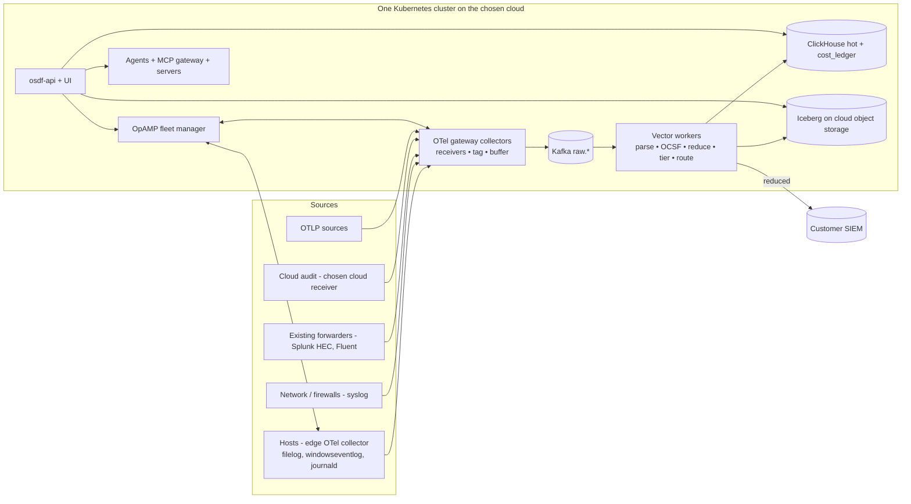

# MVP Scope: a working product with a real user experience

- Status: Draft v0.1
- Date: 2026-10-14
- **This document is authoritative for MVP scope.** Where it conflicts with the
  P0/P1 labels in [`requirements.md`](requirements.md) or the phase order in
  [`execution-plan.md`](execution-plan.md), this document wins.

## 1. What changes and why

The earlier plan produced a technically complete MVP that was mostly CLI,
Grafana and PRs. That's a good demo for engineers, but not a product people
adopt. This scope redefines the MVP as a **working product that a SOC data
engineer can install, connect data to, and use to cut cost, through a UI**,
with agents built into the experience.

Three constraints shape it:

1. **Single hosting platform.** The MVP runs on **one** deployment target: one
   Kubernetes platform on one cloud, plus Docker Compose for evaluation and
   development. No multi-cloud, BYOC SaaS control plane or warehouse
   offload in the MVP. Those are post-MVP, in
   [`saas-byoc-and-compute-offload.md`](saas-byoc-and-compute-offload.md).
   Only the cheap "decide now" items in §8 of that document are kept.
2. **OpenTelemetry-first ingestion.** Sources connect through **OpenTelemetry
   Collector receivers** (contrib or a custom OCB build), configured and managed
   from the UI over OpAMP. This replaces Vector as the *ingestion* layer.
   Vector stays the *processing* engine (OCSF normalization, reduction,
   routing) behind Kafka (see ADR-19 below).
3. **Prioritized by the primary use case** (cost reduction) first, the
   secondary use case (agentic-native) second, and detection/triage last.

### Decision: hosting platform

> **Updated by [`zero-cost-mvp.md`](zero-cost-mvp.md):** to keep upfront cost
> at $0, the MVP platform is **OCI Always Free (ARM64) running k3s**, with the
> Mac mini as an identical dev/demo host. The design partner's cloud is
> connected as an *ingestion source*. The table below is kept for the
> post-MVP choice of paid hosting.

#### Original options (for paid hosting after the MVP)

| Option | Pros | Cons |
|---|---|---|
| **The cloud of the first design partner** (recommended) | Real data, real costs, real feedback; the cloud's native receivers matter (Event Hubs, CloudWatch, Pub/Sub) | Locks MVP cloud adapters to that provider |
| AWS (EKS) default if there's no design partner yet | Largest share of security data sources; mature S3 semantics | — |
| Azure (AKS) | Strong fit for Sentinel-heavy SOCs (the cost story is ingest-driven) | Needs a native ADLS adapter instead of S3 (saas doc FR-HST-03), so slightly more work |

Whichever you choose, the MVP also ships **Docker Compose** for laptops and
evaluation. Compose isn't a second hosting platform; it's the dev/eval path.

### ADR-19: OpenTelemetry Collector for ingestion, Vector for processing

- **Decision.** The ingest edge and gateway are **OpenTelemetry Collectors** (a
  custom distribution built with OCB, containing only the receivers and
  processors we support). They are managed through **OpAMP** (native supervisor),
  and export to Kafka `raw.*` topics. Vector workers consume from Kafka and
  do parsing, OCSF mapping, reduction and routing in VRL.
- **Why.** OTel has the widest open source connector ecosystem and native
  OpAMP fleet management (the BindPlane model). It's the standard customers
  already run, and it lets the UI offer a connector catalog. VRL remains the
  better, testable language for the LLM-generated parsing and mapping that
  onboarding needs.
- **Trade-off.** Two engines. This is mitigated by a strict split: OTel = receive,
  light filter, tag, buffer, export; Vector = everything that changes event
  content. Light cost reductions (drop by attribute, sampling) *may* move to
  OTTL at the edge after the MVP (FR-COL-08).
- **Revisit** after the MVP if OTTL plus the OCSF mapping DSL compiler makes
  Vector unnecessary.

---

## 2. Target user and MVP promise

**Primary MVP user:** a security data engineer or SOC platform owner at a
company that pays per-GB SIEM ingest (Splunk/Sentinel/Elastic or similar).

**Promise:** *"In under an hour, connect your sources, see what each one costs
you, and approve AI-recommended reductions that cut SIEM-bound volume by 30%+,
without losing any data a detection needs."*

---

## 3. MVP user journeys (in priority order)

Each journey is a UX deliverable with an acceptance test. "Must" journeys
define the MVP. "Should" journeys ship if the schedule allows, otherwise
in v0.2.

| # | Journey | Priority | Acceptance (measured in usability tests) |
|---|---|---|---|
| J1 | **Install and first login**: `helm install` (or `docker compose up`), open the UI, sign in (OIDC or local admin), and a setup wizard starts | Must | A new user finishes in ≤ 30 min on the chosen platform, with no docs beyond the quickstart |
| J2 | **Connect a source** from an OTel **connector catalog**: pick a connector, fill a form (port, auth, endpoint), click deploy. The config is pushed over OpAMP. A **live tail** shows the first events, and an **OCSF preview** shows how they will be normalized | Must | First events visible ≤ 5 min after deploy; a misconfiguration shows a plain-language error with a fix |
| J3 | **See what data costs**: a rate card wizard (SIEM pricing model + $/GB) gives a **cost overview** (baseline $/month by source, top event types, trend) | Must | User can answer "which 3 sources cost the most and why" in under 2 minutes |
| J4 | **Reduce cost with AI recommendations**: a **recommendations inbox** fed by the cost optimization agent. Each card shows the proposed change in plain language, a before/after sample, projected GB/day and $/month, a detection-safety check and the agent's evidence. Actions: **Approve → deploy**, Edit, Dismiss. **One-click rollback** | Must | ≥ 1 approved recommendation deploys in under 3 min; savings show on the dashboard within one metering interval |
| J5 | **Route and retain by tier**: per source/event type, choose *SIEM + lake*, *lake only*, *archive only* or *drop*, with a live cost delta before saving | Must | Changing a tier shows projected $ impact before save; data is still searchable in the lake |
| J6 | **Investigate in the lake**: a search page (SQL editor with OCSF field autocomplete, time picker, results table, export) for data that no longer goes to the SIEM | Must | User finds a known event in lake-only data in ≤ 2 minutes |
| J7 | **Ask the copilot**: a chat panel on every page (search agent + cost agent tools) answers questions such as "why did firewall volume spike yesterday?" and "what would dropping DNS AAAA records save?", with cited queries and results | Must | ≥ 70% of a 30-question task set answered correctly (eval) and rated useful by users |
| J8 | **Connect your own agent**: an "Agent access" page creates an agent identity and token, and shows the MCP endpoint and a copy-paste config for Claude Code/Desktop and other MCP clients, plus the 5 core skills to download | Must | An external MCP client completes a cost-review task via OSDF tools |
| J9 | **Onboard an unknown log type with AI**: paste or upload a sample. The onboarding agent proposes a parser and OCSF mapping with a side-by-side preview and field coverage %. Approve it to deploy | Should | ≥ 60% of first proposals pass tests for held-out log types; the user can fix a mapping in the UI |
| J10 | **Alerts with AI triage (light)**: enable a starter Sigma pack per source. Alerts list with triage verdict, confidence, evidence and agree/disagree | Should | Seeded attack data produces alerts with triage verdicts that cite events |
| J11 | **Source health**: source list with status (healthy / silent / erroring), volume sparkline, last event, and an alert for silent sources | Must (as part of J2/J3 screens) | A silent source shows as unhealthy within 2 expected intervals |

---

## 4. UX requirements

### 4.1 Principles
1. **Value first.** The first screen after setup is the cost overview, not an
   empty pipeline editor.
2. **Git under the hood, invisible by default.** Every UI change is committed
   to the content repo as a proposal by the platform. Power users can switch
   to "view as YAML / open PR", but nobody needs Git to use the product.
3. **Preview → approve → rollback** for every change. Each change shows a before/after
   sample, the cost delta and safety checks. Rollback is one click.
4. **Cost shown at every decision point** (the primary use case).
5. **AI is accountable.** Every agent output shows what it will change,
   the evidence (linked queries/events), confidence, and what the agent run
   cost. Users can give agree/disagree feedback, which feeds evals.
6. **Plain language over jargon.** OCSF class names appear with friendly
   labels ("Authentication events"), and errors name a fix.
7. **Guided empty states.** Every page with no data explains the next step
   and links to the wizard.

### 4.2 UX functional requirements (FR-UX)

| ID | Requirement | MVP |
|---|---|---|
| FR-UX-01 | Setup wizard: platform check, admin account/OIDC, rate card, first connector | Must |
| FR-UX-02 | Connector catalog (OTel receivers) with search, categories, a form generated from each receiver's config schema, inline validation, and a test-connection step | Must |
| FR-UX-03 | Live tail per source (sampled, last N events, raw and OCSF views side by side) | Must |
| FR-UX-04 | Cost overview dashboard (baseline vs actual, by source/destination/event type, trend, net savings) | Must |
| FR-UX-05 | Recommendations inbox and proposal review (plain-language summary, diff, sample before/after, $ delta, safety check, evidence, approve/edit/dismiss) | Must |
| FR-UX-06 | Change history with one-click rollback (each entry: who/which agent, what, cost impact) | Must |
| FR-UX-07 | Tier/routing editor per source with live cost preview | Must |
| FR-UX-08 | Search page (SQL with OCSF autocomplete, time range, results grid, export CSV/JSON, save query) | Must |
| FR-UX-09 | Copilot side panel (streaming answers, cited queries, "run this" and "open in search" actions, per-answer cost) | Must |
| FR-UX-10 | Agent access page (create agent identity/token, MCP endpoint, client config snippets, skills download, per-agent activity and cost) | Must |
| FR-UX-11 | Sources list and health (status, volume sparkline, last event, errors) | Must |
| FR-UX-12 | Settings: users and roles (admin / engineer / analyst / viewer), rate card, destinations (SIEM HEC/API, lake), LLM provider config | Must |
| FR-UX-13 | Onboarding assistant (sample → proposed parser/mapping preview → approve) | Should |
| FR-UX-14 | Alerts list with triage panel and feedback | Should |
| FR-UX-15 | Visual pipeline view (read-only graph of source → route → pipeline → destinations) | Should |
| FR-UX-16 | Full visual pipeline editor, detection catalog UI, ATT&CK heatmap, fleet rollout UI | Post-MVP |

### 4.3 UX non-functional requirements (NFR-UX)

| ID | Requirement |
|---|---|
| NFR-UX-01 | Time to first value: install → first events → cost overview in **≤ 30 min** (J1–J3) |
| NFR-UX-02 | Page interactive in ≤ 1 s p75 on cached views. Live tail latency ≤ 5 s. Search shows progress, and its first page arrives in ≤ 5 s for 24 h hot data |
| NFR-UX-03 | Accessibility: WCAG 2.2 AA (keyboard navigation, contrast, screen-reader labels). Light and dark themes |
| NFR-UX-04 | Usable at 1366×768 and up. Read-only views work on tablet width |
| NFR-UX-05 | Usability testing with ≥ 5 target users at two checkpoints (prototype and beta). Success rate per journey ≥ 80% before MVP release |
| NFR-UX-06 | Consistent design system. Every component documented in a component library (Storybook) |
| NFR-UX-07 | Product analytics are **opt-in**, self-hosted, and record no event data. They measure journey funnels (J1–J8) to guide prioritization |

### 4.4 UI stack (all open source)
React + TypeScript; **shadcn/ui** (MIT, on Radix primitives) + Tailwind CSS;
TanStack Query/Table/Router; **Apache ECharts** (Apache-2.0) for charts;
**Monaco** for SQL/YAML; React Flow for the read-only pipeline view;
Storybook; Playwright for E2E journey tests. Use **Penpot** (MPL-2.0) for
design prototypes, if you want an open source design tool. Grafana stays for
*operator* dashboards only, not for end-user UX.

---

## 5. Prioritized requirements

Legend: **Must** = in MVP v0.1; **Should** = in MVP if on schedule, otherwise
v0.2; **Post** = v0.2–v1.0; **Later** = after v1.0. "Lite" means a reduced
version, described in the notes.

### 5.1 Ingestion (OpenTelemetry-first)

| Req | Priority | MVP notes |
|---|---|---|
| FR-COL-08 OTel Collector runtime | **Must** (promoted) | Custom OCB distribution; **gateway collector** in the cluster (Deployment) + optional **edge collector** (DaemonSet/VM package) |
| FR-COL-04 Fleet management (OpAMP) | **Must (lite)** | Enroll, show status/version/health, push config from the UI, rollback to the previous config. Staged rollouts are Post |
| FR-COL-01 Network/protocol sources | **Must** via OTel receivers | See connector list §5.1.1 |
| FR-COL-02 Cloud/SaaS API sources | **Must for the chosen platform's cloud only**; others Post | For example, `azureeventhub` on Azure, `awscloudwatch`/S3 on AWS, `googlecloudpubsub` on GCP |
| FR-COL-06 Ingest tagging | **Must** | OTel `resource`/`attributes` processors set `osdf.tenant_id`, `source_id`, `collector_id`, raw size |
| FR-COL-07 Edge buffering | **Must** | OTel `file_storage` extension + exporter sending queue |
| FR-COL-03 Native edge agent packages | Should | Ship the OTel distribution as deb/rpm/MSI with the OpAMP supervisor |
| FR-COL-05 Declarative connector framework | **Must (lite)** (promoted) | The connector package format, `otel_receiver`, `object_storage` and lite `http_pull` engines, generated UI forms, and the `osdf connector new/validate/test` CLI, so the community can add connectors without code. See [`connectors-framework.md`](connectors-framework.md) (FR-CON-01..16) |
| FR-COL-09 Staged rollouts | Post | |
| FR-COL-10 Forwarder migration helpers | Post | |

#### 5.1.1 MVP connector catalog (OTel receivers)

Choose receivers at **beta or stable** stability in `opentelemetry-collector-contrib`
where possible. Check the stability level of each one when you build the
distribution, and mark alpha receivers "preview" in the UI.

| Connector (OTel receiver) | Use | Priority |
|---|---|---|
| `otlp` (gRPC/HTTP) | Any OTel-instrumented source or upstream collector | Must |
| `syslog` (+ `tcplog`/`udplog`) | Firewalls, network devices, Linux | Must |
| `filelog` | Log files on hosts (edge collector) | Must |
| `windowseventlog` | Windows Security/System events (edge collector) | Must |
| `splunk_hec` | **Intercept existing Splunk/HEC forwarders.** The fastest path to cost savings: point HEC at OSDF, reduce, then forward to Splunk | Must |
| `kafka` | Existing Kafka log topics | Must |
| **`object_storage` engine: AWS S3, Azure Blob/ADLS Gen2, Google Cloud Storage** | Notification-driven ingest + backfill of logs that land in cloud storage (CloudTrail, VPC/NSG flow, audit sinks, exports), across all three clouds regardless of hosting platform | **Must** (see [`connectors-framework.md`](connectors-framework.md) §5) |
| Cloud receiver for the chosen platform (`azureeventhub` / `awscloudwatch` / S3-based / `googlecloudpubsub`) | Cloud audit and activity logs | Must (chosen cloud only) |
| `journald` | systemd hosts | Should |
| `fluentforward` | Existing Fluentd/Fluent Bit fleets | Should |
| `webhookevent` | SaaS webhooks | Should |
| `k8sobjects` / `k8s_events` | Kubernetes audit/events | Post |
| `sqlquery` | Database-held logs | Post |

Each catalog entry is a **connector package** (connectors-framework §3): receiver form schema, default
attributes, Kafka topic mapping, Vector parser + OCSF mapping, fixtures,
reduction presets and a cost estimate profile.

**MVP source packs (OCSF-mapped, with reduction presets):** Linux auth/syslog,
Windows Security, one firewall (choose the design partner's: for example, Palo
Alto or Fortinet syslog), generic HEC JSON passthrough, and **cloud storage
packs for all three clouds**: AWS CloudTrail + VPC flow (S3), Azure Activity
logs (Blob), GCP Audit logs (GCS), plus generic NDJSON/CSV bucket packs.
**Must.** Two reference SaaS API connectors (Okta, GitHub audit) on
`http_pull` prove the framework: **Must**. DNS, proxy, Entra sign-in and Azure/GCP
flow-log packs are Should.

### 5.2 Pipeline, schema, storage

| Req | Priority | MVP notes |
|---|---|---|
| FR-PIP-01/02 Pipelines and routes as content | **Must** | Authored mostly through the UI; YAML remains available |
| FR-PIP-03 Destinations | **Must (lite)** | Lake (Iceberg), ClickHouse (hot), **one SIEM destination** (Splunk HEC *or* Sentinel Logs Ingestion API, per the design partner), Kafka |
| FR-PIP-04 Full-fidelity raw archive | **Must** | It's the safety net that makes aggressive reduction acceptable |
| FR-PIP-06 Persistent queues (Kafka) | **Must** | |
| FR-PIP-07 Preview/test mode | **Must** | Powers live tail, proposal before/after and onboarding previews |
| FR-PIP-12 Per-route metrics | **Must** | Feeds the cost ledger |
| FR-PIP-08 Packs | **Must (lite)** | Built-in packs only. Import/export and a registry are Post |
| FR-PIP-09 Sensitive data guard | Should | Basic credential/secret masking rules |
| FR-PIP-10/15 Enrichment, TI enrichment | Post | GeoIP is Should if cheap |
| FR-PIP-05 Replay | Post | Lake search covers MVP investigations. Selective replay comes in v0.2 |
| FR-PIP-11, 13, 14 | Post | |
| FR-SCH-01 OCSF canonical | **Must** | |
| FR-SCH-04 DLQ with reasons | **Must** | Shown in the source health UI |
| FR-SCH-05 Bronze/gold layers | **Must (lite)** | Bronze + gold. Silver is Post |
| FR-SCH-03 Schema registry | Should | Lite: observed fields per source (drives OCSF autocomplete) |
| FR-SCH-02 ECS/CIM adapters | Later | |
| FR-LAK-01/02/04/05 Iceberg + ClickHouse hot | **Must** | Single platform storage only. Adapter interface kept (saas doc §8) |
| FR-LAK-03 Retention policies | **Must (lite)** | Fixed tier defaults, editable in Settings |

### 5.3 Cost (primary use case): almost entirely Must

| Req | Priority | MVP notes |
|---|---|---|
| FR-CST-01 Rate card | **Must** | Wizard in setup |
| FR-CST-02 Metering / cost ledger | **Must** | |
| FR-CST-03 Baseline capture | **Must** | |
| FR-CST-04 Savings report | **Must** | Cost overview + CSV export |
| FR-CST-05 Reduction library | **Must** | |
| FR-CST-06 Tier policies | **Must** | UI tier editor (J5) |
| FR-CST-07 Detection-safety guard | **Must (lite)** | Uses imported SIEM rule/search field lists (upload or API import) + any enabled Sigma rules |
| FR-CST-08 What-if simulation | **Must** | Proposal review shows projected $ |
| FR-CST-12 Platform cost visibility | **Must (lite)** | Configured infra cost per month + LLM token cost → net savings |
| FR-CST-14 Efficient storage formats | **Must** | |
| FR-CST-09 Budgets/alerts | Should | |
| FR-CST-11 Lake-first investigation | **Must** | J6 |
| FR-CST-10 Chargeback | Later | |
| FR-CST-13 Labor-cost metrics | Post | |

### 5.4 Agents and agentic-native surface (secondary use case)

| Req | Priority | MVP notes |
|---|---|---|
| FR-AGT-02 Cost optimization agent | **Must** | Feeds the recommendations inbox (J4) |
| FR-AGT-06 Search agent | **Must** | Powers the copilot (J7) |
| FR-AGT-10 Copilot chat | **Must** | Side panel, tools limited by the user's role |
| FR-AGT-12 Model routing | **Must (lite)** | One hosted provider + one local option via LiteLLM; set in Settings |
| FR-AGT-11 Agent evals | **Must** | For the agents that ship |
| FR-AGT-01 Onboarding agent | Should | J9 |
| FR-AGT-07 Triage agent | Should | J10 |
| FR-AGT-04 Detection engineering agent | Post | |
| FR-AGT-03, 05, 08, 09 Drift, tuning, investigation, blueprints | Post | Blueprints are internal only in the MVP (Temporal is optional; APScheduler is fine for the MVP) |
| FR-AGN-01 Domain MCP servers | **Must (lite)** | `osdf-data`, `osdf-cost`, `osdf-pipeline` (read + propose). `osdf-alerts`/`osdf-detect` arrive with J10 |
| FR-AGN-02 Current MCP spec | **Must** | |
| FR-AGN-05 Agent-first tool design | **Must** | |
| FR-AGN-12 MCP gateway | **Must (lite)** | Auth, per-tool RBAC, budgets, audit. Third-party servers are Post |
| FR-AGN-13 Agent identity | **Must** | J8 |
| FR-AGN-15 Agent observability and cost | **Must** | Shown per answer and on the Agent access page |
| FR-AGN-08 Agent Skills | **Must (lite)** | 5 skills: `reduce-siem-cost`, `connect-otel-source`, `investigate-in-lake`, `explain-cost-spike`, `onboard-log-source` |
| FR-AGN-04 Approval inside the agent loop | Should | The MVP approves in the OSDF UI (proposal review) |
| FR-AGN-06/07 Resources, prompts | Should | |
| FR-AGN-03, 09, 10, 11, 16 | Post | |
| FR-AGN-14, 17 A2A, BYO-agent kit | Later | |

### 5.5 Detection, search, graph

| Req | Priority | MVP notes |
|---|---|---|
| FR-SRC-01 Unified SQL search (hot + lake) | **Must** | J6 |
| FR-SRC-05 Query guardrails | **Must** | Time range required, scan estimate shown |
| FR-SRC-04 Saved searches, export | **Must (lite)** | Save + export; notebooks are Post |
| FR-SRC-02 Federated search | Post | |
| FR-SRC-03 Pipe query language | Later | |
| FR-DET-01/02/03/04 Sigma, compile to ClickHouse, scheduled, CI | Should | J10 with a starter pack per MVP source |
| FR-DET-05–11 Lifecycle, correlation, ATT&CK, health, armory, exceptions | Post | |
| FR-GRF-01–03 Graph | Post | Field-usage tables are enough for the safety check in the MVP |
| FR-HLT-01 Silent sources | **Must** | J11 |
| FR-HLT-05 Data quality score | Should | |
| FR-HLT-02/03/04 Volume anomaly, drift, drift agent | Post | |

### 5.6 Platform, API, security, operations

| Req | Priority | MVP notes |
|---|---|---|
| FR-API-01 Versioned API (OpenAPI) | **Must** | The UI is built only on the public API |
| FR-API-04 CLI | Should | Lite: `osdf validate/test` for CI on content |
| FR-API-05 Alert webhook | Should | With J10 |
| FR-API-03 External MCP client support | Post | |
| NFR-SEC-01 OIDC + RBAC | **Must** | 4 roles. Keycloak bundled; any OIDC provider supported |
| NFR-SEC-02 TLS | **Must** | mTLS for OpAMP/collectors |
| NFR-SEC-03 Secrets | **Must** | The platform's native secret store or Kubernetes Secrets + SOPS |
| NFR-SEC-04 Audit log | **Must** | Visible in change history |
| NFR-SEC-05 Signed images, SBOM | Should | |
| NFR-AI-01/02/04/05/06 Agent safety, residency, determinism, MCP security, context efficiency | **Must** | |
| NFR-AI-03 LLM tracing | **Must** | |
| NFR-TEN-01 Multi-tenancy | **Must (lite)** | `tenant_id` + `data_plane_id` everywhere, one tenant in the UI |
| NFR-OPS-01 Deployability | **Must** | **Helm on the chosen platform** + Compose for eval |
| NFR-OPS-02 Self-observability | **Must** | Operator Grafana dashboards |
| NFR-OPS-03 Upgrades | **Must (lite)** | `helm upgrade` with migration jobs. Zero-downtime is Post |
| NFR-OPS-04 GitOps | **Must (lite)** | Embedded Git (Gitea) by default; external Git is Should |
| NFR-PERF-01 | **Must (scaled)** | $0 lean profile: ≥ 2k EPS / ~5–20 GB/day on OCI Always Free (zero-cost-mvp §3). Standard profile: ≥ 20k EPS / ~500 GB/day |
| NFR-COST-01–05 | **Must** | |
| NFR-LIC-01 | **Must** | |
| SaaS/BYOC (FR-HST, FR-SAAS, FR-OFF) | Post | Only the saas doc §8 "decide now" items are Must |

### 5.6a AI data optimization (Gemini and other LLMs)

See [`ai-data-optimization.md`](ai-data-optimization.md). MVP priorities:
storage optimizer (lite), NL flow/routing optimizer, transformation
assistant (lite), template miner, Gemini as a first-class provider with
data-use policy, and AI cost accounting are **Must**. Per-template LLM
labeling is **Should**. The runtime AI step is **Post**.

### 5.7 Explicitly out of the MVP
Multi-cloud deployment; the SaaS control plane and BYOC; Snowflake/Databricks
offload; federated search; replay UI; drift detection and remediation; detection
lifecycle, correlation and ATT&CK coverage; investigation agent; A2A; third-party
MCP servers through the gateway; OTel-edge OTTL reductions; staged fleet
rollouts; MSSP mode; marketplace listings.

---

## 6. MVP architecture delta (single platform, OTel-first)

Changes to `architecture.md`:
- **Ingestion:** the collector tier is OTel (gateway + optional edge), not
  Vector sources. Raw archive writes move from the collectors to a Vector worker
  "archive" route that runs before any reduction (simpler: one writer, same
  guarantee).
- **Fleet:** the OTel OpAMP supervisor is used directly. `osdf-sidecar` is only
  needed for Vector workers, and in the MVP they're plain Kubernetes Deployments
  rendered by the config service, so the sidecar becomes Post.
- **Trino:** optional in the MVP. Lake search can run through ClickHouse's
  Iceberg table engine/functions (or DuckDB) to save a component, if
  performance is acceptable on the reference dataset. Decide in week 3 with a
  benchmark.
- **Temporal:** optional in the MVP (APScheduler + Postgres jobs). Adopt it when
  long-running agent workflows and replay arrive.
- **Product UI** (React app) replaces Grafana as the user surface.

---

## 7. Revised MVP timeline (16 weeks, with a UX track)

| Weeks | Platform/data track | UX/product track | Agent track |
|---|---|---|---|
| 0–1 | Decide hosting platform and design partner; cost baseline (execution plan §1.1a); repo + CI | 5 user interviews; journey map; clickable prototype of J1–J5 | Pick LLM providers; eval dataset plan |
| 1–4 | OTel distribution (OCB) + OpAMP; gateway → Kafka → Vector → ClickHouse + Iceberg on the chosen cloud; cost ledger metering; osdf-api skeleton + OIDC | Design system + app shell; setup wizard; sources list | — |
| 4–7 | Connector framework: package format, `otel_receiver` + `object_storage` (S3/Blob/GCS) engines, generated forms; MVP connector packs + OCSF mappings; live tail; rate card; baseline; SIEM destination | Connector catalog + forms (J2); cost overview (J3); **usability test #1 on the prototype/alpha** | MCP gateway + `osdf-data`/`osdf-cost` (read) |
| 7–10 | Reduction library; tier policies; simulation; safety check; proposals + deploy + rollback; `http_pull` engine + Okta/GitHub reference connectors | Recommendations inbox + proposal review (J4); tier editor (J5); change history | **Cost optimization agent**; agent identity |
| 10–13 | Lake search path; saved searches; guardrails; silent-source health | Search page (J6); copilot panel (J7); agent access page (J8) | Search agent; 5 skills; evals in CI |
| 13–15 | Hardening, performance at reference footprint, Helm upgrade path, security review | Polish, accessibility pass, empty states, docs; **usability test #2 (beta)** | Should items: onboarding agent (J9), Sigma starter pack + triage (J10) if on track |
| 15–16 | **MVP v0.1 release** on the chosen platform; design-partner deployment | Quickstart, in-app guides | Eval scorecard published |

**Team for this timeline:** 1 data/infra, 2 backend (Python), 1 full-time
frontend, 1 product designer (part-time after week 7), 1 agent/ML engineer,
plus a product owner (part-time). With fewer people, keep all Must items and
drop Should items rather than stretching UX quality.

This replaces milestones M3–M5 of the execution plan with:

| Milestone | Week | Exit |
|---|---|---|
| **MVP-α** | 7 | J1–J3 working on the chosen platform; OTel protocol connectors + S3/Blob/GCS storage ingestion working; usability test #1 done |
| **MVP-β** | 13 | J4–J8 working; cost agent and copilot in the UI; external MCP client works |
| **MVP v0.1** | 16 | All Must journeys pass acceptance; ≥ 80% task success in usability test #2; design partner live, with net savings measured against their baseline |

---

## 8. MVP definition of done
0. **Connectors:** all Must connectors in the catalog pass offline and live
   tests, including S3, Azure Blob and GCS ingestion with notifications and
   backfill. An external contributor builds and merges an L0/L1 connector in
   ≤ 4 hours using only the docs and CLI.
1. All **Must** journeys (J1–J8, J11) pass their acceptance tests in automated
   Playwright E2E runs on the chosen platform *and* in usability tests (≥ 80%
   task success, n ≥ 5).
2. **≥ 30% SIEM-bound volume reduction** on the design partner's top sources,
   with **zero** detection-relevant fields removed (safety check report), and
   net savings shown after platform and LLM cost.
3. Install to first value in ≤ 30 min (NFR-UX-01), measured on a clean account.
4. Agent evals: cost agent recommendations accepted ≥ 50% of the time by design
   partner users; copilot ≥ 70% correct on the task set.
5. Security: OIDC/RBAC, audit, agent identities and gateway policy reviewed
   against the NSA MCP guidance / OWASP Agentic Top 10 checklist. No critical
   findings open.
6. Docs: quickstart, connector guide, cost model explainer, agent access guide.
