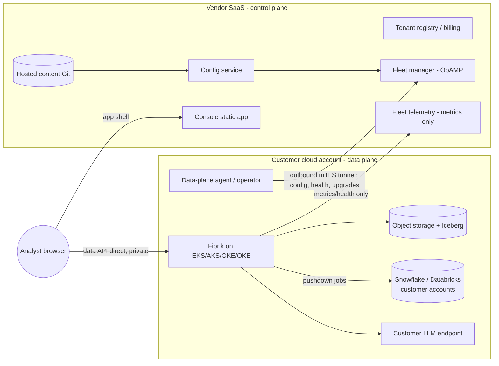
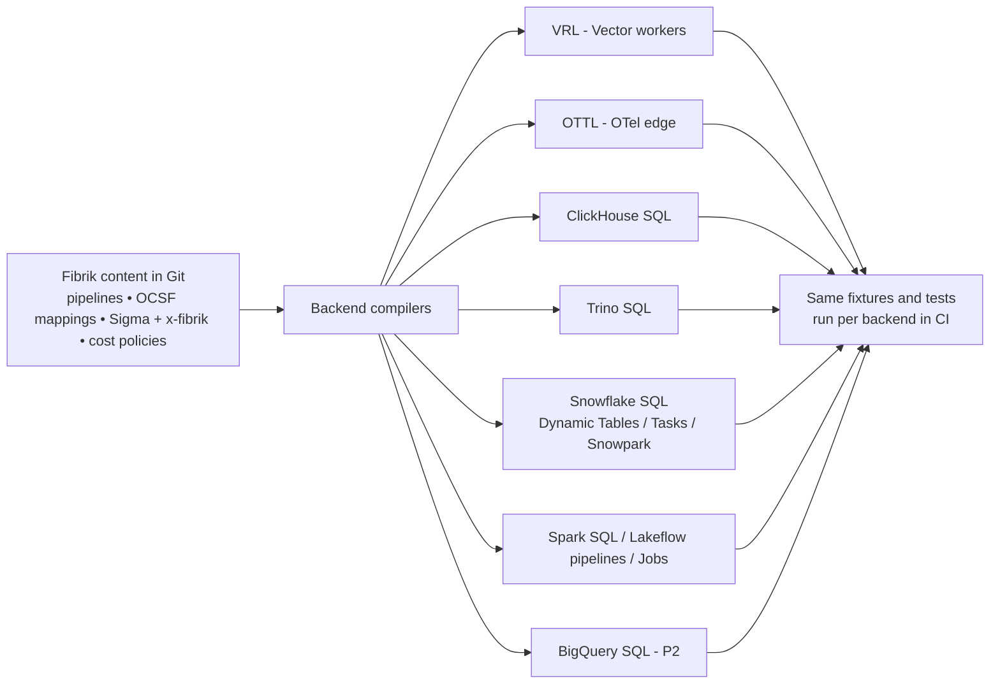

# Requirements Assessment: SaaS/BYOC Hosting and Compute Offload

- Status: Draft v0.1
- Date: 2026-10-14
- Extends: [`requirements.md`](requirements.md), [`architecture.md`](architecture.md), [`execution-plan.md`](execution-plan.md)

> **Timing:** everything here is **post-MVP**. The MVP runs on a single
> hosting platform (see [`mvp-scope.md`](mvp-scope.md)). Only the "decide now"
> items in §8 apply during the MVP.

This assessment covers two linked capabilities:

1. **A SaaS-hosted version of Fibrik** in which the customer hosts the core
   application in **their own cloud account** (AWS, Azure, Google Cloud,
   Oracle Cloud Infrastructure, or on-prem Kubernetes), while the service
   provider operates it as a managed service.
2. **Compute offload.** The customer can push data processing (storage,
   transformation, detection, search, backtests) to a **data platform they
   already pay for**: Snowflake, Databricks, and later BigQuery, Microsoft
   Fabric and others. Fibrik's own engines then do only what those platforms
   can't do well.

Both capabilities serve the primary use case (cost reduction, requirements
G0). Running in the customer's account uses their committed cloud spend and
avoids egress. Offloading uses Snowflake or Databricks capacity they have
already bought, instead of duplicating it. Both also serve the secondary use
case (an agentic-native platform, GA), because agents reach every execution
backend through the same MCP tools.

---

## 1. Summary of the assessment

| Question | Assessment |
|---|---|
| Is the current architecture compatible? | **Mostly.** Fibrik already separates the control plane from the data plane, uses open formats (Iceberg/Parquet, OCSF, Sigma) and runs on Kubernetes. The gaps are: (a) the control plane isn't multi-tenant or SaaS-operable yet; (b) storage is S3-API-only, while Azure needs native ADLS/Blob; (c) the Iceberg catalog is fixed (Lakekeeper); (d) execution is assumed to happen in ClickHouse/Trino/Vector; (e) Temporal and the agents assume one trust zone. |
| Recommended hosting model | **Managed BYOC**: a vendor-operated, multi-tenant **control plane (SaaS)**, and a **data plane deployed into the customer's cloud account**. The data plane connects outbound only, and **no customer event data crosses into the control plane**. Self-managed open source stays available, and fully hosted SaaS is a later option. |
| Recommended offload model | An **open lake + pluggable execution backends**. Data lands once in Iceberg. Each workload (transform, detect, search, backtest, cost analysis) is then *placed* on an execution backend: Fibrik-native, Snowflake, Databricks, or others. A **cost-aware placement engine** decides where, and agents use one tool surface regardless of backend. |
| Cloud coverage | Tier 1: AWS, Azure, GCP. Tier 2: OCI. Tier 3: on-prem/any CNCF Kubernetes. All use one Helm chart plus per-cloud OpenTofu modules and provider adapters. |
| Biggest risks | Catalog interoperability limits (who can write which Iceberg tables); the vendor's control plane becoming a path for exfiltration; per-cloud test matrix cost; warehouse costs exceeding Fibrik-native costs when offload is placed badly. |
| Effort | About 12–16 extra weeks after the pilot-ready milestone (M7), in four increments (§9). A few **foundation decisions must be made now** so the MVP doesn't have to be reworked (§8). |

---

## 2. Deployment models

| Model | Control plane | Data plane | Who operates | Use when |
|---|---|---|---|---|
| **M1 Self-managed (open source)** | Customer's cloud | Customer's cloud | Customer | Air-gapped, regulated, or DIY |
| **M2 Managed BYOC** (recommended SaaS) | Vendor SaaS (multi-tenant) | **Customer's cloud account / VPC** | Vendor operates both, through least-privilege, audited access | Most enterprises: data stays in their account, ops are outsourced, committed cloud spend is used |
| **M3 Fully hosted SaaS** (later, optional) | Vendor SaaS | Vendor-hosted, single-tenant per customer | Vendor | Small customers and MSSPs who don't want to run cloud infrastructure |

"Genuine BYOC" test (from industry practice): **the vendor must not be
able to see event payloads.** Management traffic (config, health, metrics,
upgrades) may cross the boundary. Query results, events, alerts with raw
evidence, and LLM prompts that contain event data must not.

### 2.1 What lives where (M2)

| Component | Control plane (vendor SaaS) | Data plane (customer account) |
|---|---|---|
| Web console (static app, auth) | ✔ | — |
| Tenant registry, subscriptions, billing, licensing | ✔ | — |
| Fleet manager (OpAMP) | ✔ (multi-tenant; config, health and version only) | Sidecars / OTel supervisors |
| Content Git (packs, rules, skills) | ✔ hosted, **or** the customer's own Git | — |
| Config service (render/validate) | ✔ (renders config; contains no data) | Validator sandbox for anything that runs samples |
| Collectors, Kafka, Vector workers, lake writer | — | ✔ |
| Object storage, Iceberg catalog, ClickHouse, Trino | — | ✔ (or the customer's warehouse; see §4) |
| Detection runner, correlator, health/drift | — | ✔ |
| Temporal | Optional server in the control plane, **with payload encryption by customer-held keys**; workers in the data plane | ✔ workers (default: whole Temporal in the data plane) |
| Agent runtime, LLM gateway, MCP gateway + servers | — | ✔ (LLM calls go to the customer's chosen model endpoint) |
| Metadata-only agents (for example, a fleet health assistant) | ✔ (allowed, because they see only metadata) | — |
| Cost ledger (detailed) | Aggregates only (for billing) | ✔ full detail |
| Audit log | Control-plane actions | Data-plane actions (customer-owned) |

**Browser data path:** the console UI loads from the SaaS, but every data
call (search, alerts, evidence) goes **directly from the browser to the
customer's data-plane endpoint** (private link / VPN / IP allowlist), with the
same OIDC token. The control plane never proxies data responses.

---

## 3. Multi-cloud hosting requirements

### 3.1 Provider abstraction: map each dependency to a managed service or a self-hosted default

| Capability | AWS | Azure | Google Cloud | Oracle Cloud (OCI) | Self-hosted default |
|---|---|---|---|---|---|
| Kubernetes | EKS | AKS | GKE | OKE | Any CNCF k8s / k3s |
| Object storage | S3 | **ADLS Gen2 / Blob (not S3 API; needs a native adapter)** | GCS (native; S3 interop is limited) | Object Storage (offers an S3 compatibility API; verify feature coverage) | SeaweedFS / Ceph RGW |
| Kafka-compatible bus | MSK | Event Hubs (Kafka endpoint) | Managed Service for Apache Kafka | OCI Streaming (Kafka-compatible API) | Apache Kafka (Strimzi) |
| PostgreSQL | RDS / Aurora | Azure Database for PostgreSQL Flexible Server | Cloud SQL / AlloyDB | OCI Database with PostgreSQL | CloudNativePG |
| Secrets | Secrets Manager | Key Vault | Secret Manager | OCI Vault | OpenBao |
| Keys (CMK/BYOK) | KMS | Key Vault keys / Managed HSM | Cloud KMS | OCI Vault keys | OpenBao transit |
| Workload identity | IRSA / Pod Identity | Entra Workload ID | GKE Workload Identity | OKE workload identity | SPIFFE/SPIRE |
| Private connectivity | PrivateLink | Private Link | Private Service Connect | Private Endpoints | VPN / WireGuard |
| Hosted LLM option | Bedrock | Azure AI Foundry / Azure OpenAI | Vertex AI | OCI Generative AI | vLLM / Ollama |
| Native SIEM/lake target | Security Lake (OCSF) | Sentinel / Sentinel data lake, Fabric OneLake | Google SecOps, BigQuery | Oracle Autonomous DB (Iceberg support to be verified) | — |

> Check the service names, Kafka-compatibility limits and S3-compatibility
> limits for each cloud at implementation time. These change often.

### 3.2 Functional requirements: hosting (FR-HST)

| ID | Requirement | Pri |
|---|---|---|
| FR-HST-01 | **One Helm chart** deploys the full data plane on EKS, AKS, GKE, OKE and generic Kubernetes. Cloud specifics live in values profiles (`aws`, `azure`, `gcp`, `oci`, `generic`) | P0 |
| FR-HST-02 | **Infrastructure as code per cloud:** OpenTofu modules (MPL-2.0; Terraform is BSL, so avoid it on the default path) for network, cluster, buckets, Kafka, Postgres, KMS, identities and private endpoints. Each module has a *managed-service* or *self-hosted* switch per dependency | P0 |
| FR-HST-03 | **Storage adapter layer:** S3 API, plus native **ADLS Gen2/Blob** and **GCS** for collectors' archives (Vector sinks), Iceberg FileIO (Iceberg supports S3/ADLS/GCS FileIO) and replay readers. No direct cloud SDK calls outside provider adapters | P0 |
| FR-HST-04 | **Kafka abstraction:** tested against Apache Kafka, MSK, Event Hubs (Kafka endpoint), GCP Managed Kafka and OCI Streaming. A documented matrix of unsupported features (for example, Kafka Connect or transaction support on some services) with fallbacks | P1 |
| FR-HST-05 | **Workload identity everywhere**: no long-lived cloud keys in pods. Per-component cloud roles with least privilege (a generated IAM policy document for each cloud) | P0 |
| FR-HST-06 | **Customer-managed keys** for object storage, Postgres, Kafka, ClickHouse disks and Temporal payloads, from the customer's KMS | P1 |
| FR-HST-07 | **Region and residency pinning**: all data-plane resources, LLM endpoints and warehouse targets in customer-selected regions. Policy checks block cross-region data flows unless explicitly allowed | P1 |
| FR-HST-08 | **Marketplace delivery**: listings on AWS, Azure, GCP and OCI marketplaces so customers can use committed spend (MACC/EDP/CUD/UCM). Metering integration where the model requires it | P2 |
| FR-HST-09 | **Conformance test matrix**: nightly E2E on each tier-1 cloud (deploy → ingest → detect → agent task → upgrade → teardown), weekly on tier-2/3 | P1 |
| FR-HST-10 | **Footprint profiles** (small / medium / large) with sizing and *estimated monthly cloud cost per profile* for each provider (primary use case: no surprises) | P1 |

### 3.3 Functional requirements: SaaS control plane and BYOC operations (FR-SAAS)

| ID | Requirement | Pri |
|---|---|---|
| FR-SAAS-01 | **Multi-tenant control plane:** tenant registry, orgs/workspaces, environments (dev/prod) and data planes per tenant (one tenant can have many data planes across clouds/regions) | P0 |
| FR-SAAS-02 | **Data-plane bootstrap:** a customer runs one OpenTofu module or a marketplace template that creates the data plane and registers it with a one-time token. After that, everything is managed from the control plane | P0 |
| FR-SAAS-03 | **Outbound-only connectivity:** the data plane opens an mTLS (or WireGuard-based) tunnel to the control plane. No inbound ports in the customer's network. The tunnel carries only management traffic (config, health, upgrades, metrics) | P0 |
| FR-SAAS-04 | **No customer event data in the control plane.** The data classes allowed to cross are enumerated and enforced by an egress policy at the tunnel: config, schema/field names, counts, metrics, health, error codes. A test suite proves raw events, query results and LLM prompts never cross | P0 |
| FR-SAAS-05 | **Managed upgrades:** release channels (rapid/stable/LTS), maintenance windows set by the customer, canary across tenants, automatic rollback, and version skew support (control plane N supports data planes N-2) | P0 |
| FR-SAAS-06 | **Break-glass support access:** vendor engineers get no standing access. Just-in-time access needs the customer's approval, is time-boxed, scoped to the data plane's operational namespace, and fully recorded in the customer-owned audit log | P0 |
| FR-SAAS-07 | **Control-plane identity:** customer SSO (OIDC/SAML) and SCIM provisioning. RBAC is federated so the same roles apply in the console and the data plane | P0 |
| FR-SAAS-08 | **Content Git choice:** a vendor-hosted Git per tenant, or a connection to the customer's GitHub/GitLab/Azure DevOps/Bitbucket. Proposals (PRs) from agents go to whichever is configured | P1 |
| FR-SAAS-09 | **Content distribution:** signed packs, skills and rule updates published by the vendor/community. Tenants subscribe per channel, and updates arrive as proposals, never as forced changes | P1 |
| FR-SAAS-10 | **Usage metering and billing** from data-plane aggregates (GB processed, data planes, agent tasks). Customers can see exactly what is reported | P1 |
| FR-SAAS-11 | **Disconnected mode:** if the tunnel is down, the data plane runs on its last known good config (NFR-REL-02). A fully **air-gapped** variant runs the control plane inside the customer account (= M1 with vendor support) | P1 |
| FR-SAAS-12 | **Fleet observability for the vendor:** health and SLOs per data plane from metrics only. No logs containing event data leave the customer account; support bundles are redacted and customer-approved | P1 |
| FR-SAAS-13 | **Tenant offboarding:** export everything (content repo, config, audit, cost ledger), then revoke and destroy control-plane records. The data plane and its data stay with the customer | P1 |
| FR-SAAS-14 | **MSSP mode:** one provider org manages many customer tenants with delegated admin, each customer's data plane isolated in that customer's own cloud | P2 |

---

## 4. Compute offload to customer data platforms

### 4.1 What can be offloaded, and what should not be

| Workload | Offload candidate? | Notes |
|---|---|---|
| Collection, edge filtering, routing, masking | **No** (stays on Vector/OTel) | Needs low latency, runs at the edge or in streaming, and decides what data reaches the warehouse at all. That is where most of the cost reduction happens |
| Raw archive / bronze | Storage only | It lives in the customer's object storage, which the warehouse can read |
| Parse → OCSF normalization (silver → gold) | **Yes** | Push down as SQL, or keep in Vector. Choose by cost (§4.4) |
| Enrichment with large reference tables (CMDB, identity, TI) | **Yes** | Joins are usually cheaper where the reference data already lives |
| Storage of gold / long retention | **Yes** | Iceberg tables in the customer's lake, readable by all engines |
| Scheduled detections | **Yes** | Compile Sigma to Snowflake SQL / Spark SQL / BigQuery SQL |
| Streaming detections | Partial | Platform streaming exists (Snowflake Dynamic Tables/Streams+Tasks, Databricks Structured Streaming), but latency and cost need checking. The Fibrik-native path is the default |
| Correlation over signals | **Yes** | Windowed SQL |
| Threat hunting / search | **Yes** | Via federated adapters, or directly on shared Iceberg |
| Backtests, cost what-ifs, field-usage analysis | **Yes** | Large historical scans are the warehouse's strength |
| Agent reasoning (LLM calls) | Optional | Customers may use the platform's hosted models (for example, Snowflake Cortex, Databricks Model Serving) through the LLM gateway, with the same egress policies |

### 4.2 Integration patterns

**P1. Shared open lake (preferred, zero-copy).** Fibrik writes gold OCSF data as
**Iceberg** tables in the customer's object storage and registers them in an
**Iceberg REST catalog**. Snowflake, Databricks, BigQuery and Trino all query
the same files. Current state of interoperability (as of October 2026;
verify before you build):

- **Snowflake:** catalog-linked databases connect to external Iceberg REST
  catalogs and can **write** to externally managed Iceberg tables (preview
  since July 2025). External engines can also write to **Snowflake-managed**
  Iceberg tables through the Horizon Catalog's Iceberg REST endpoint (GA May
  2026). So Fibrik can use either its own catalog or Snowflake Horizon as the
  catalog of record.
- **Databricks:** the Unity Catalog Iceberg REST endpoint gives external
  engines read/write/create on **UC-managed Iceberg tables** (Public Preview),
  and read access to Delta tables through UniForm. **Foreign Iceberg tables
  (governed by another catalog) are read-only** in Databricks. If Databricks
  must write to Fibrik tables, UC has to be the catalog of record for those tables.
- **Google BigQuery / Lakehouse (formerly BigLake) runtime catalog:** an Iceberg
  REST catalog with credential vending. Open source engines write; BigQuery
  writes to these tables are in Preview (June 2026).

  ⇒ Requirement: Fibrik must treat **the catalog as pluggable**, and choose the
  catalog of record per table group based on which engines need to write.

**P2. Native ingest + pushdown transformation.** When a customer wants
platform-native tables (for example, Snowflake standard tables, Delta), Fibrik
delivers normalized or partially normalized data into the platform's
ingestion path. For Snowflake, that's Snowpipe/Snowpipe Streaming or files
plus COPY. For Databricks, it's Auto Loader on cloud files, or a direct
stream. Fibrik then **generates platform-native transformation jobs** from the
same Fibrik content (§4.3).

**P3. Detection and query pushdown.** The detection compiler gains warehouse
dialects (pySigma backends: evaluate the existing community backends for
Snowflake/Databricks and build the missing ones). The runner executes them
through platform APIs (the Snowflake SQL API, the Databricks SQL Statement
Execution API) on a customer-chosen warehouse/cluster. Alternatively, it
**deploys them as native scheduled objects** (Snowflake Tasks, Databricks
Jobs) and reads results back into Fibrik's `signals`/`alerts`.

**P4. Federated search** (already in requirements FR-SRC-02). Agents and
hunters query the platform in place, in its own dialect, with results mapped
to OCSF fields.

### 4.3 One content model, many execution backends

The Fibrik content (pipelines, OCSF mappings, rules) stays the single source of
truth. Compilers target each backend:

- The **OCSF mapping DSL** (execution plan Phase 2) is declarative, so it can
  compile to SQL `SELECT … AS ocsf_field` projections with regex/JSON
  functions for each dialect. Mappings that use features a backend can't
  express fail at compile time. They are never silently approximated.
- **Equivalence testing:** each pack's fixtures run on every enabled backend
  in CI (ephemeral Snowflake/Databricks test schemas, or recorded fixtures).
  Outputs must match the VRL reference output.
- **Generated artifacts are proposals** like everything else: a PR shows the
  generated Snowflake/Databricks objects, and deploy happens via the backend's
  API under a dedicated service principal.

### 4.4 Cost-aware placement (ties to the primary use case)

A **placement engine** decides where each workload runs. It records each
decision and can explain it:

| Input | Source |
|---|---|
| Fibrik-native compute cost | `cost_ledger` (vCPU-hours, storage) |
| Warehouse cost | Snowflake `ACCOUNT_USAGE` (warehouse metering, credits) and Databricks `system.billing` usage tables, imported into the `cost_ledger` with the customer's contract rates |
| Data gravity and egress | Where the input tables live (cloud/region), egress $/GB |
| Latency SLO | Workload class (streaming detection vs nightly backtest) |
| Pre-paid capacity | Unused committed credits/DBUs (cheaper in effect at the margin) |
| Policy | Customer rules (for example, "PII tables never leave Snowflake") |

Example outcomes: high-volume normalization stays on Vector (cheap linear
CPU). A 90-day backtest runs on the customer's Databricks cluster, where
the data already sits. Scheduled identity detections run in Snowflake, next
to the IdP tables. **Projected and actual cost per placement** is reported
in the savings dashboard. A re-placement is a proposal that includes the
projected saving.

### 4.5 Functional requirements: offload (FR-OFF)

| ID | Requirement | Pri |
|---|---|---|
| FR-OFF-01 | **Execution backend interface** (`ExecutionBackend`: `capabilities()`, `estimate()`, `compile()`, `deploy()`, `run()`, `results()`, `cost()`) with implementations: `fibrik-native` (Vector/ClickHouse/Trino), `snowflake`, `databricks`. Later: `bigquery`, `fabric`, `clickhouse-cloud` | P0 (interface + native), P1 (Snowflake, Databricks), P2 (others) |
| FR-OFF-02 | **Pluggable Iceberg catalog** via the Iceberg REST spec: Lakekeeper (default), Snowflake Horizon / Open Catalog, Databricks Unity Catalog, Google Lakehouse runtime catalog, AWS Glue (REST endpoint), Apache Polaris. Per table group: catalog of record, plus engines granted read/write | P0 (interface), P1 (Snowflake/UC) |
| FR-OFF-03 | **Credential vending**: Fibrik and engines get short-lived, scoped storage credentials from the catalog. No static storage keys are shared between Fibrik and warehouses | P1 |
| FR-OFF-04 | **Pushdown compilers** for OCSF mappings and Sigma rules to Snowflake SQL and Spark SQL (Databricks), with per-backend capability flags and fail-loud behavior | P1 |
| FR-OFF-05 | **Native deploy targets**: Snowflake (Dynamic Tables, Streams + Tasks, Snowpipe Streaming ingest), Databricks (Lakeflow/declarative pipelines, Jobs, Auto Loader). Desired state lives in Git and is reconciled, so drift is detected | P1 |
| FR-OFF-06 | **Results return path**: detections run on a warehouse write signals to a results table. Fibrik ingests them into `signals`/`alerts` with full provenance (backend, query ID, cost) | P1 |
| FR-OFF-07 | **Cross-backend equivalence tests** in CI for every pack and rule enabled on more than one backend | P1 |
| FR-OFF-08 | **Warehouse cost ingestion** into the `cost_ledger` (Snowflake metering views, Databricks billing system tables) with tag-based attribution: Fibrik sets query tags/job tags on everything it runs | P1 |
| FR-OFF-09 | **Placement engine** with policies, explainable decisions, projected vs actual cost, and re-placement proposals | P2 (manual placement P1) |
| FR-OFF-10 | **Guardrails on warehouse spend**: per-workload credit/DBU budgets, a warehouse size cap, automatic suspend, query timeouts and kill switches. Agents can't scale warehouses up | P1 |
| FR-OFF-11 | **Agent tools are backend-agnostic**: `search_sql`, `backtest_rule` and `simulate_pipeline` accept `backend=auto` and return where they ran and what it cost. The MCP gateway policy can pin sensitive datasets to their home platform | P1 |
| FR-OFF-12 | **Governance passthrough**: respect the platform's own row/column policies (Snowflake masking/row access policies, UC grants). Fibrik service principals get the minimum roles needed, and Fibrik never widens access | P1 |
| FR-OFF-13 | **Hot-store substitution**: customers with Snowflake or Databricks can run *without ClickHouse*, using the warehouse as the hot store, with documented latency and cost trade-offs | P2 |

---

## 5. Non-functional requirements (additions)

| ID | Category | Requirement |
|---|---|---|
| NFR-SAAS-01 | Data boundary | Zero customer event data in the control plane, verified by automated egress tests and an annual third-party assessment |
| NFR-SAAS-02 | Availability | Control plane 99.9%. Data plane availability is independent: it keeps processing for ≥ 7 days without the control plane |
| NFR-SAAS-03 | Compliance (SaaS) | SOC 2 Type II and ISO 27001 for the control plane in year 1. Alignment with FedRAMP Moderate / EU sovereign-cloud options is a later decision (affects region strategy) |
| NFR-SAAS-04 | Tenant isolation | Control-plane data partitioned per tenant (separate schemas or row-level security plus per-tenant encryption keys). No cross-tenant queries are possible from application roles |
| NFR-SAAS-05 | Upgrade safety | Zero data loss during upgrades. Rollback within one release. Maintenance windows respected |
| NFR-SAAS-06 | Supply chain | Every artifact pulled by data planes is signed (cosign) and verified at admission (policy controller). Customers can mirror images to their own registry |
| NFR-OFF-01 | Interop honesty | The capability matrix per backend (read/write/stream/catalog) is published and tested. No feature is shown in the UI for a backend that can't run it |
| NFR-OFF-02 | Cost transparency | Every offloaded run reports its warehouse cost within 24 h (metering lag) and is shown in the savings dashboard |
| NFR-LIC-02 | SaaS licensing | The vendor-operated control plane uses only components whose licenses allow offering them as a service. AGPL components (for example, Grafana, Garage) are used unmodified or kept to the customer data plane, or replaced (Perses for dashboards). No SSPL/BSL components |

---

## 6. Architecture changes needed

| Area | Current design | Change |
|---|---|---|
| Control plane | Single-tenant services next to the data plane | Split into a **SaaS control plane** (tenant registry, console, fleet manager, config service, content distribution, billing) and a **data-plane operator** (a Kubernetes operator that reconciles the desired state received over the tunnel) |
| Fleet (OpAMP) | Single tenant | Multi-tenant OpAMP server. Tenant-scoped enrollment tokens. Per-tenant signing keys for config bundles |
| Storage | S3 API | Storage adapter layer (S3, ADLS, GCS) for Vector sinks, the lake writer, replay and the validator |
| Catalog | Lakekeeper fixed | Catalog abstraction over the Iceberg REST spec. Per table group: catalog of record + grants |
| Execution | ClickHouse/Trino/Vector assumed | `ExecutionBackend` interface + backend compilers + placement engine |
| Temporal | One cluster | Default: Temporal in the data plane. Option: server in the control plane with payloads encrypted by a customer-held codec key |
| Agents/MCP | One zone | Agents and the MCP gateway always in the data plane. Control-plane agents are limited to metadata tools (fleet health, content) |
| Console | Served by `fibrik-api` | Static SaaS app. Data APIs called directly on the data-plane endpoint (private) |
| Cost ledger | Fibrik-only costs | Adds warehouse metering import, cloud cost (billing exports: CUR, Azure Cost Management, GCP billing export, OCI cost reports) and placement attribution |
| IaC | Compose + Helm | + OpenTofu modules per cloud, marketplace templates, data-plane bootstrap module |

New ADRs to record:
- **ADR-15:** Managed BYOC is the SaaS model, and event data never enters the control plane.
- **ADR-16:** The Iceberg REST catalog is pluggable, and the catalog of record is chosen per table group by which engines must write.
- **ADR-17:** Execution backends sit behind one content model and compiler set, with cost-aware placement.
- **ADR-18:** OpenTofu, not Terraform, for IaC (licensing).

---

## 7. Security and trust model for BYOC

- **Vendor access is the main new threat.** Mitigations: outbound-only
  tunnel; an enumerated egress allowlist of data classes; signed config bundles
  that the data plane verifies before applying; the customer can pin or
  hold upgrades; JIT break-glass with customer approval; all vendor actions
  in the customer-owned audit log; an option for customer-held content-signing
  keys (the vendor proposes, the customer signs).
- **Cross-tenant risk** in the control plane: per-tenant keys, row-level
  security, separate fleet-manager channels, and a cross-tenant pen test
  in every release.
- **Warehouse credentials**: Fibrik uses dedicated service principals with
  key-pair/OIDC workload identity federation where supported (Snowflake supports
  OIDC workload identity federation for Horizon access), never user passwords.
  Credentials are stored in the customer's secret store, not the control plane.
- **Agents**: unchanged rules (proposal-only writes, gateway policy). New
  policy dimension: `backend` and `dataset_home`, so an agent can't move data
  out of its home platform unless policy allows.

---

## 8. Decisions to make now, so the MVP doesn't need rework

These cost little during the MVP (execution plan weeks 1–12) and are
expensive to add later:

1. **Keep `tenant_id` everywhere** (already planned) **and a `data_plane_id`**
   on every config object, deployment and metric.
2. **Do all object storage access through one adapter interface.** Implement
   S3 only in the MVP, but no direct `boto3`/S3 calls elsewhere.
3. **Use the Iceberg REST catalog API only.** No Lakekeeper-specific calls,
   so Snowflake Horizon, Unity Catalog and others can be swapped in.
4. **Put the `ExecutionBackend` interface around the detection runner and search
   router from day one.** Only `fibrik-native` is implemented in the MVP.
5. **Keep the control-plane/data-plane boundary clean in code:** the config
   service and fleet manager never read event data, and the console's data
   calls go only through `fibrik-api` in the data plane.
6. **Use OpenTofu for any IaC** written during the pilot.
7. **Make the cost ledger schema backend-aware:** add `backend`, `query_id`,
   `credits`/`dbu` and `cloud` columns now.
8. **Keep the license policy SaaS-safe:** check AGPL/SSPL/BSL in CI now
   (NFR-LIC-01 + NFR-LIC-02).

---

## 9. Phased plan (after pilot-ready milestone M7, week 22)

| Increment | Weeks | Scope | Exit criteria |
|---|---|---|---|
| **S1 Multi-cloud self-managed** | 22–25 | Helm values profiles; OpenTofu modules for AWS, Azure, GCP; ADLS/GCS adapters; Kafka matrix (MSK, Event Hubs, GCP Managed Kafka); nightly conformance on 3 clouds | Same E2E suite green on EKS, AKS and GKE; documented cost per footprint profile |
| **S2 Managed BYOC control plane** | 25–30 | Multi-tenant control plane, data-plane operator, outbound tunnel, bootstrap module, egress allowlist and tests, managed upgrades, JIT access, SSO/SCIM | A test tenant deploys a data plane into its own Azure subscription from the console; the egress test suite proves no event data leaves; an upgrade and rollback work |
| **S3 Offload v1: shared lake + Snowflake/Databricks** | 30–34 | Pluggable catalog (Horizon, UC), credential vending, Snowflake and Databricks backends for detections and search, results return path, warehouse cost ingestion, spend guardrails | Same Sigma pack runs on native, Snowflake and Databricks with equivalent results; warehouse cost visible per rule; agent `search_sql(backend=auto)` works |
| **S4 Transformation pushdown + placement** | 34–38 | OCSF mapping → Snowflake SQL / Spark SQL compilers, native deploy (Dynamic Tables, Lakeflow/Jobs), equivalence tests, manual then policy-based placement, OCI tier-2 profile | Customer switches normalization of one source from Vector to Snowflake through a proposal; the savings dashboard shows the cost difference per placement |
| S5 (later) | — | BigQuery, Fabric/OneLake, Sentinel data lake backends; marketplace listings; fully hosted SaaS (M3); MSSP mode | Driven by demand |

Running in parallel: SOC 2 readiness for the control plane starts at S2.

---

## 10. Open questions

1. **Business model:** is the SaaS a commercial offering built on the open
   source core (open core / managed service), or a community-run hosted
   service? This affects which features (control plane, placement engine)
   stay open source. Recommendation: keep the data plane and all content formats
   fully open, and keep the hosted control plane as the managed service.
2. **Which first data platform:** Snowflake or Databricks? Choose based on the
   pilot customers. Snowflake's external-engine write support via Horizon is
   currently GA. Databricks' managed Iceberg and UC Iceberg REST endpoint are
   in Public Preview.
3. **Catalog of record default** when a customer has *both* Snowflake and
   Databricks. Candidate rule: Unity Catalog for tables Databricks must write,
   Horizon for tables Snowflake must write, and Fibrik's Lakekeeper otherwise.
   Snowflake can write through catalog-linked databases.
4. **Sovereign/regulated clouds** (Azure Government, GCP sovereign, OCI
   dedicated region): in scope for year 1?
5. **Who pays for warehouse compute** used by Fibrik workloads, and how is that
   shown? (It's the customer's account, but the placement engine must make it
   visible.)

---

## Sources

- Snowflake: write support for externally managed Iceberg tables and catalog-linked databases (Preview, Jul 2025): https://docs.snowflake.com/release-notes/2025/other/2025-07-18-iceberg-external-writes-cld
- Snowflake: external query engine writes via Horizon Catalog (GA, May 2026): https://docs.snowflake.com/release-notes/2026/other/2026-05-26-tables-iceberg-query-using-external-query-engine-snowflake-horizon-writes-ga
- Snowflake: externally managed Iceberg writes docs: https://docs.snowflake.com/en/user-guide/tables-iceberg-externally-managed-writes
- Databricks: Apache Iceberg in Databricks: https://docs.databricks.com/aws/iceberg
- Databricks: managed tables (UC managed Iceberg, Public Preview): https://docs.databricks.com/aws/tables/managed
- Databricks: announcing full Apache Iceberg support: https://databricks.com/blog/announcing-full-apache-iceberg-support-databricks
- Onehouse critique of Databricks Iceberg support (competitor viewpoint): https://www.onehouse.ai/blog/databricks-iceberg-support-has-a-catch-its-called-unity-catalog
- Google Lakehouse for Apache Iceberg (BigLake) release notes: https://docs.cloud.google.com/lakehouse/docs/release-notes?authuser=0
- BigLake Iceberg tables: https://docs.cloud.google.com/biglake/docs/biglake-iceberg-tables
- ClickHouse BYOC architecture: https://clickhouse.com/docs/products/bring-your-own-cloud/overview/architecture
- ClickHouse BYOC on Google Cloud GA: https://clickhouse.com/blog/byoc-gcp-ga
- BYOC in practice (groundcover): https://www.groundcover.com/blog/byoc-in-practice-architectures-tradeoffs-lessons
- BYOC options overview (Northflank): https://northflank.com/blog/best-options-for-byoc-in-cloud-computing
