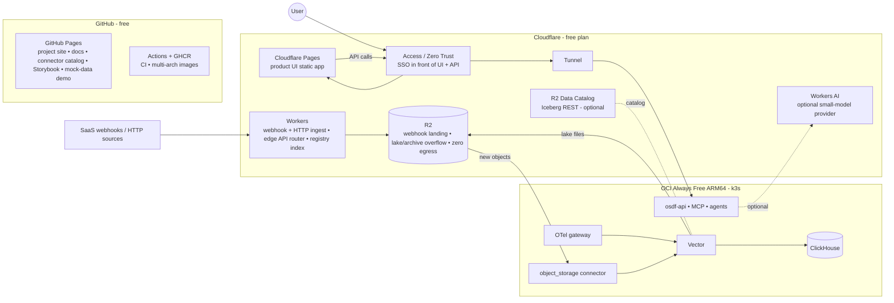

# $0 Upfront MVP: building and running on free tiers

- Status: Draft v0.1
- Date: 2026-10-14
- Applies to: [`mvp-scope.md`](mvp-scope.md) (single hosting platform, OTel-first, connectors framework)

## 1. Goal and ground rules

**Goal:** build, demo and run a design-partner pilot of the OSDF MVP with
**$0 upfront cost and $0 running cost**, using only open source software
and free tiers. A small, explicit upgrade path covers growth beyond them.

Ground rules:
1. **Always-free over trials.** Prefer services that stay free indefinitely.
   Use time-limited credits only for short tests, never for something the
   MVP depends on.
2. **No surprise bills.** Every cloud account gets a budget alert at $1, uses
   free-only/no-upgrade plans where available, and has a documented "what costs
   money" list (§7).
3. **Free tiers change without notice.** For example, OCI's Always Free Ampere
   allowance was reportedly cut from 4 OCPU/24 GB to 2 OCPU/12 GB in June 2026,
   while some Oracle pages still show the old figure. So the design **fits the
   smaller allowance**, and every limit below must be re-checked against the
   provider's own page when you sign up.
4. **No real customer data in free LLM tiers** whose terms allow training on
   inputs. Develop with synthetic or sanitized data. The design partner's real
   data uses a local model or the partner's own API key.
5. **Same code as production.** The free setup is a *profile* of the same Helm
   chart and Compose files, not a fork.

## 2. Recommended $0 hosting platform

| Option | What's free | Fit | Verdict |
|---|---|---|---|
| **Oracle Cloud (OCI) Always Free** | Ampere A1 ARM compute (**2 OCPU / 12 GB** assumed; 4/24 on some tenancies), block storage (~200 GB total), object storage (S3-compatible API), outbound data allowance, load balancer | The only always-free tier large enough to run the whole MVP stack on one VM | **Primary MVP host** |
| **Your Mac mini** (Apple Silicon) + Cloudflare Tunnel | Hardware you already own; ARM64 like OCI A1 | A good dev, demo and fallback host with the same images | **Dev/demo host + fallback** |
| GCP Always Free | One e2-micro VM (US regions), 5 GB Cloud Storage (US regions) | Too small to host the stack | Ingestion test source only |
| AWS (new accounts) | Free plan with $100–$200 credits for up to 6 months, plus always-free services with monthly caps | Credits expire, and the free plan closes the account at 6 months | Ingestion test source only |
| Azure free account | $200 credit for 30 days + 12 months of selected services + always-free services | Credit is short-lived | Ingestion test source only |

**Decision:** the MVP's single hosting platform is **OCI Always Free (ARM64)**,
running **k3s** on one Ampere A1 VM. The Mac mini runs the identical stack
for development and demos. AWS, Azure and GCP are used only as **ingestion
sources** (S3, Blob, GCS connectors) within their free allowances, which
also proves the multi-cloud storage connectors at $0.

Consequences:
- **ARM64-first images.** Every OSDF image is built multi-arch (arm64 +
  amd64). Check that the third-party images used are available for arm64:
  OTel Collector, Vector, ClickHouse, Postgres, Lakekeeper and Caddy all have
  arm64 builds, but confirm each pinned tag.
- **Idle reclamation.** OCI may reclaim Always Free VMs that stay under 20%
  CPU, network *and* (for A1) memory at the 95th percentile over 7 days. A
  running OSDF stack uses well over 20% memory, but monitor it. Upgrading the
  tenancy to pay-as-you-go removes reclamation and keeps Always Free resources
  free. It also needs a card, so add a $1 budget alert first.
- **Capacity.** A1 capacity is sometimes unavailable in popular regions.
  Pick a less busy home region at sign-up (the home region can't be changed
  later), and keep the Mac mini as a fallback.

## 3. The "lean" deployment profile (fits 2 OCPU / 12 GB)

The full architecture is kept, but optional components are turned off and the
heavy ones are tuned for low memory. The profile is `values-free.yaml` (Helm) /
`compose.free.yaml`.

| Component | Lean profile choice | Memory budget |
|---|---|---|
| k3s (single node) | Traefik disabled (Caddy used instead), metrics-server on | ~0.6 GB |
| OTel Collector (gateway, OCB build) | `memory_limiter` + `file_storage` persistent queue | ~0.3 GB |
| **Message bus** | **Off.** OTel → OTLP → Vector, with persistent disk queues on both sides (OTel `file_storage`, Vector disk buffers). Kafka is a switch in the standard profile | 0 (Kafka: ~1 GB if enabled) |
| Vector workers (1 replica) | Disk buffers, bounded concurrency | ~0.5 GB |
| ClickHouse | `max_server_memory_usage` ≈ 2.5 GB, small caches, TTL 7 days | ~2.5 GB |
| PostgreSQL (control plane + Iceberg catalog) | `shared_buffers` 128 MB | ~0.4 GB |
| Lakekeeper (Iceberg REST catalog) | Shares Postgres | ~0.2 GB |
| Lake writer | Inside the osdf-worker process (pyiceberg micro-batches) | (shared) |
| osdf-api + MCP servers + agents | One Python process group (uvicorn workers), split into separate deployments only in the standard profile | ~1.2 GB |
| UI | Static build served by Caddy (also TLS/reverse proxy) | ~0.05 GB |
| Search over the lake | ClickHouse Iceberg table functions (no Trino) | (in ClickHouse) |
| Scheduler/jobs | APScheduler + Postgres job table (no Temporal) | (shared) |
| Self-monitoring | VictoriaMetrics single-node + vmagent (lighter than Prometheus) and the OSDF UI health pages. Grafana optional | ~0.4 GB |
| Auth | Built-in local users + OIDC login via free providers (GitHub, Google). No Keycloak in the lean profile | (shared) |
| Content Git | A free GitHub repo (or local bare repo), with no Gitea in the lean profile | 0 |
| Ingress | **Cloudflare Tunnel** (free), so no public IP or open ports are needed; Cloudflare Access for SSO; UI optionally served from Cloudflare Pages (§4a) | ~0.05 GB |
| LLM | External free-tier or BYO-key APIs through the LiteLLM SDK in-process (no proxy service). No local model in the lean profile | (shared) |
| **Total** | | **~6.2 GB used, ~5.8 GB headroom** |

**Capacity of the lean profile (to be benchmarked in week 3):** roughly
2–5k events/sec sustained, so **about 5–20 GB/day of raw ingest**. That's
enough for the MVP demo and a scoped design-partner pilot (a few high-cost
sources), with 7 days hot in ClickHouse and a 2–4 week lake within the free
object storage allowance (compressed Parquet ~10× smaller than raw).

**Storage layout:** the boot volume (OS + k3s) plus one block volume for
ClickHouse, buffers and Postgres, kept within the Always Free block storage
total. Object storage holds the Iceberg lake and the raw archive. If the free
object storage allowance is too small, add Cloudflare R2's free tier
(S3-compatible, no egress fees). Re-check its current free allowance first.

## 4. Free services for everything else

| Need | Free option | Notes |
|---|---|---|
| Source code, issues, project board | GitHub Free (public repo) | Public repos are recommended for an open source project. Private repos are free too, with lower Actions limits |
| CI/CD | GitHub Actions (free for public repos, including arm64 Linux runners) | Multi-arch builds, unit tests, connector tests, Playwright E2E on Compose |
| Container registry | GitHub Container Registry (free for public images) | Signed with cosign (free, keyless via GitHub OIDC) |
| Docs site, Storybook, connector catalog site, demo UI with mock data | **GitHub Pages** (see §4a) | Not for the product UI: GitHub's terms don't allow Pages to host commercial SaaS |
| Dev environments | Laptops/Mac mini + Docker; GitHub Codespaces free monthly quota | |
| Design and prototyping | Penpot (open source, free cloud or self-hosted) | |
| Domain/TLS | Cloudflare Tunnel hostname on a domain you own, or a free `*.trycloudflare.com` URL for demos; TLS included | A custom domain is the one optional purchase (~$10/yr); not needed for the MVP |
| Email notifications | None in the MVP (in-app + webhook). Later, a free transactional email tier | |
| Error tracking / product analytics | Self-hosted, opt-in, inside the platform (writes to ClickHouse) | No third-party SaaS needed |
| LLM for development | Free API tiers on **synthetic data only** (for example, Gemini Flash free tier, Groq, OpenRouter `:free` models, Mistral). Check each provider's data-use terms; some free tiers use inputs to improve products | Rate limits are fine for development and evals at small scale |
| LLM for the design partner | **The partner's own API key** (BYO key, zero cost to you), or a local model on their hardware or your Mac mini | Configured in Settings (FR-AGT-12) |
| Threat intel feeds (later) | Open feeds (abuse.ch, etc.) | |
| Test data | OTRF Security-Datasets, synthetic generators, Atomic Red Team output | |

## 4a. Edge and serverless layer: Cloudflare and GitHub Pages

> **Portability update ([`initial-stack.md`](initial-stack.md), ADR-23):** the
> initial stack uses only portable components (Caddy for ingress/TLS/UI, Dex
> for OIDC, the in-collector webhook engine). The Cloudflare services below
> are **optional add-ons** that can be placed in front of the portable core
> later. GitHub Pages stays in use for the static docs/catalog site.

Free edge and serverless services take **stateless, light work** off the single
OCI VM, add an ingestion buffer that keeps working when the VM is down, and
give the project a public face at $0. Heavy processing (OTel, Vector,
ClickHouse, agents) **stays on OCI**. Workers can't run those engines, and
their free CPU limits are measured in milliseconds per request.

| Service | Role in OSDF | Free allowance (verify at sign-up) | Limits that shape the design |
|---|---|---|---|
| **GitHub Pages** | Project website, documentation, **connector catalog browser** (generated from the registry repo), Storybook, a clickable **demo of the UI with mock data** | 1 GB site, ~100 GB/month soft bandwidth; builds via Actions | **Not for the product UI or anything SaaS-like** (GitHub terms). Static only |
| **Cloudflare Pages** | Hosts the **product UI** (React static build), so it loads even when the OCI VM is busy or down; preview deployments per PR | Free static hosting | Static only. The data API stays on OCI behind Access + Tunnel |
| **Cloudflare Workers** | (1) **Webhook / HTTP ingestion endpoint**: verify signatures, add the ingest envelope, batch to R2 as NDJSON. (2) **Edge API router**: checks the Access JWT, rate-limits, and forwards to the Tunnel. (3) **Connector registry index API** for the in-product catalog. (4) Cron Triggers for tiny housekeeping jobs | ~100k requests/day | Very small CPU time per request (milliseconds), so no parsing at the edge, only validate and batch. Request volume suits SaaS webhooks, not syslog/firewall streams |
| **R2** | Landing bucket for edge ingestion; **lake/archive overflow** with **zero egress fees** (also cheap to read from any cloud later) | ~10 GB storage + monthly operation allowances | Small. Lake retention planning must count R2 + OCI object storage together |
| **R2 Data Catalog** (optional) | Managed **Iceberg REST catalog** for tables on R2, which could replace Lakekeeper in the lean profile (saves memory and a component) | Pricing announced May 2026 with a monthly free tier (1M catalog operations, 10 GB compaction); billing not yet enabled at the time of writing | Leave automatic compaction off, or within the free tier. Keep the catalog pluggable (saas doc FR-OFF-02) |
| **Queues** (optional) | Decouple Worker ingest from R2 writes, and R2 event notifications → OSDF | Reportedly added to the Workers free plan in 2026; confirm the allowance | Polling R2 listings works if Queues isn't available |
| **Access / Zero Trust** | SSO and device posture in front of the UI and API, with no IdP to run | Free for small teams (up to ~50 users) | Use OIDC in OSDF as well, so access doesn't depend on Cloudflare |
| **Tunnel** | Ingress to OCI with no public IP and no open ports | Free | — |
| **Workers AI** (optional) | Small-model provider for low-stakes tasks (template labeling drafts, summaries) behind the LLM gateway | Daily free allocation on select models | Check its data-use terms and set the provider's `trains_on_input` flag accordingly |
| **D1 / KV / Durable Objects** | Not used for core state (Postgres on OCI stays the system of record) | — | D1's free plan enforces daily row limits from September 2026; avoid it for core state |

**Other free options considered:** Vercel and Netlify (their hobby tiers have
non-commercial terms, so Cloudflare Pages is the better UI host); Neon or
Supabase free Postgres (an option to move the control-plane DB off the VM,
at the cost of an external dependency); and the Grafana Cloud free tier (an
option for operator monitoring instead of self-hosted VictoriaMetrics).

**Trade-offs to accept or reject consciously:**
- **Data passes through Cloudflare** on the webhook path and the UI/API path.
  TLS is terminated at Cloudflare's edge. That's fine for the MVP and most
  pilots, but document it for design partners with residency rules, and
  offer a direct OTel ingestion path that bypasses Cloudflare.
- **More moving parts.** Each edge piece is optional and switchable off with a
  profile flag. The MVP must still run fully on the Mac mini or the OCI VM
  alone.
- **Free-plan limits** are enforced by hard failures (for example, Workers
  request caps). Worker ingest returns `429` with retry hints, and sources
  that can't retry should use the direct OTel path.

**Requirements added (FR-EDGE):**

| ID | Requirement | MVP |
|---|---|---|
| FR-EDGE-01 | Product UI deployable as a static app on Cloudflare Pages (API base URL configurable) | Must |
| FR-EDGE-02 | Project site, docs, connector catalog browser and mock-data demo on GitHub Pages, built by Actions | Must |
| FR-EDGE-03 | Worker-based webhook/HTTP ingest → R2 NDJSON batches → `object_storage` connector (R2 as an S3-compatible source) | Should |
| FR-EDGE-04 | Cloudflare Tunnel + Access in front of the OCI deployment (with OSDF's own OIDC still enforced) | Must |
| FR-EDGE-05 | R2 as an additional lake/archive bucket; R2 Data Catalog as an optional Iceberg catalog | Should |
| FR-EDGE-06 | Workers AI as an optional LLM provider behind the gateway, with a data-use flag | Post |
| FR-EDGE-07 | Every edge component is optional; the platform runs without Cloudflare | Must |

## 5. Cloud storage ingestion at $0 (S3, Azure Blob, GCS)

The storage connectors (connectors-framework §5) are tested against all three
clouds without paying, by keeping test volumes tiny:

| Cloud | Free allowance to use (verify at sign-up) | Test setup |
|---|---|---|
| **Google Cloud** | Always Free: 5 GB Standard Cloud Storage in US regions + monthly operation allowances; Pub/Sub has a free monthly allowance | A bucket in `us-central1` with Pub/Sub notifications, and a GCP Audit Logs sink limited to a test project |
| **AWS** | New-account free plan credits ($100–$200, ≤ 6 months) + always-free monthly caps (SQS/SNS) | An S3 bucket with an SQS notification and a CloudTrail trail on a test account. Note that the free plan account closes at 6 months, so finish S3 tests early or move them to a design partner's account |
| **Azure** | Free account ($200 for 30 days, then 12 months of selected services and always-free services) | A Storage account + Event Grid → Storage Queue, and Activity logs exported to the storage account |

Rules: keep each test bucket under 1 GB, use synthetic or your own test
accounts' logs, delete test data after each run, and set a $1 budget alert
on every account. **Egress** from these clouds to OCI counts against each
cloud's free outbound allowance. At MVP test volumes, that's a few hundred MB.

## 6. What changes in the MVP design

| Area | Change for $0 |
|---|---|
| Hosting decision (mvp-scope §1) | **OCI Always Free ARM64 + k3s** is the single platform; Mac mini for dev/demo |
| Message bus | Optional. The lean profile uses OTLP + disk queues. The bus interface stays, so Kafka can return in the standard profile without changing connectors or pipelines |
| Trino, Temporal, Keycloak, Gitea, Langfuse, Grafana | Off in the lean profile; replaced by ClickHouse Iceberg functions, APScheduler, built-in auth + free OIDC, GitHub, OTel GenAI traces stored in ClickHouse, and OSDF UI health pages. Each one is a profile switch |
| Performance target (NFR-PERF-01) | MVP target on the lean profile: **≥ 2k EPS sustained / ~5–20 GB/day**, benchmarked in week 3. The standard profile keeps the original targets |
| Agents | LLM via the in-process LiteLLM SDK. A per-provider data-use policy flag in Settings blocks real data from going to "trains-on-input" providers |
| Images | Multi-arch from day one |

These changes stay within the architecture. The standard and production
profiles (Kafka, Trino, Temporal, Keycloak, multiple replicas) still apply
after the MVP or for paying deployments.

## 7. What would cost money (and how we avoid it)

| Risk | Avoidance |
|---|---|
| Exceeding OCI Always Free shapes or storage | Pin VM shape and volume sizes in OpenTofu; CI check on IaC that rejects non-free shapes |
| Upgrading a cloud account to paid by accident | Stay on free-only plans; $1 budget alerts on every account; document who may upgrade |
| Cloud egress during storage-connector tests | Small test files; same-region buckets; delete after test |
| LLM usage beyond free limits | Rate limiting + daily token budgets in the LLM gateway logic (NFR-COST-04); fail gracefully to "copilot unavailable, try later" |
| GitHub Actions minutes on private repos | Public repo (unlimited standard runner minutes for public repos) |
| Domain name | Optional; use a Cloudflare-provided hostname for demos |
| Free tier terms change | Quarterly review of all free allowances; Mac mini fallback; profile switch to a paid footprint documented with its monthly cost |

## 8. Upgrade path when free isn't enough (no rework)

| Trigger | Next step | Rough monthly cost (verify) |
|---|---|---|
| > ~20 GB/day or need for HA | Same Helm chart, `values-standard.yaml`, on a paid VM or managed Kubernetes in the design partner's (or your) cloud | Low hundreds of USD at 100–200 GB/day; benchmark first |
| Design partner wants it in their account | Install the same chart in their cloud, so they pay their own infrastructure (the BYOC path, saas doc) | Customer's cost |
| Need for a local LLM | A GPU VM or the customer's model endpoint | Varies |
| Real SaaS | saas-byoc-and-compute-offload.md increments S1–S4 | Funded stage |

## 9. Changes to the MVP timeline (mvp-scope §7)

- **Week 0:** create OCI (free-only), GitHub org/repo, Cloudflare (free), and
  free accounts on AWS/Azure/GCP for connector tests. Set budget alerts.
  Confirm current allowances and record them in `docs/free-tier-ledger.md`.
- **Weeks 1–3:** the lean profile (k3s on OCI ARM + Compose on the Mac mini),
  multi-arch CI, and the **lean benchmark** (EPS and memory) that confirms
  the §3 budget.
- **Weeks 4–7:** storage connector tests against GCS (always free) first, then
  S3 and Azure Blob within their credit windows. Schedule them deliberately,
  since the AWS free plan closes at 6 months and Azure's credit lasts 30 days.
- **Ongoing:** a free-tier ledger review at each milestone.

## 10. MVP definition of done: $0 additions
1. The whole MVP runs on **OCI Always Free (ARM64)** with the lean profile, and
   identically on the Mac mini.
2. **Total spend is $0.00** across all accounts for the build and the pilot
   (billing screenshots in the release notes).
3. S3, Azure Blob and GCS ingestion are demonstrated within free allowances.
4. A documented one-command switch to the standard profile on paid
   infrastructure, with its expected monthly cost.

## Sources (free-tier terms change often; re-verify)
- GitHub Pages limits and terms: https://docs.github.com/en/pages/getting-started-with-github-pages/github-pages-limits
- Cloudflare free limits 2026 (third-party summary): https://eastondev.com/blog/pt/posts/dev/20260526-cloudflare-free-limits/
- Cloudflare free tier 2026 cautions: https://agentdeals.dev/vendor/cloudflare
- Cloudflare changelog (D1 free-plan daily limits from Sep 2026): https://13213614.previews.developers.cloudflare.com/changelog/
- R2 Data Catalog pricing announced (May 2026): https://developers.cloudflare.com/changelog/post/2026-05-11-r2-data-catalog-pricing-announced/
- R2 Data Catalog pricing: https://developers.cloudflare.com/r2/data-catalog/platform/pricing/
- R2 Data Catalog public beta: https://blog.cloudflare.com/fr-fr/r2-data-catalog-public-beta/
- OCI Always Free resources (official): https://docs.oracle.com/en-us/iaas/Content/FreeTier/resourceref.htm
- InfoQ on OCI Always Free Ampere reduction (Jul 2026): https://infoq.com/news/2026/07/oracle-cloud-free-tier-limits/
- What's actually free on OCI in 2026: https://macmyths.com/oracle-cloud-free-tier-whats-actually-free-in-2026/
- AWS Free Tier in 2026 (credits, free plan): https://infratally.com/articles/aws-free-tier-2026/
- AWS Free Tier explained 2026: https://spot.rackspace.com/blog/aws-free-tier
- Cloud provider free tiers 2026: https://freetier.co/articles/cloud-provider-free-tiers-2026
- Azure free tier guide 2026: https://agentdeals.dev/azure-free-tier-2026
- Gemini API free tier changes (Apr 2026): https://agentdeals.dev/gemini-api-pricing-changes
- Free AI APIs: limits and data policies: https://aireiter.com/blog/best-free-ai-api
- Free LLM API comparison 2026: https://blogs.novita.ai/free-llm-api-comparison-2026/
